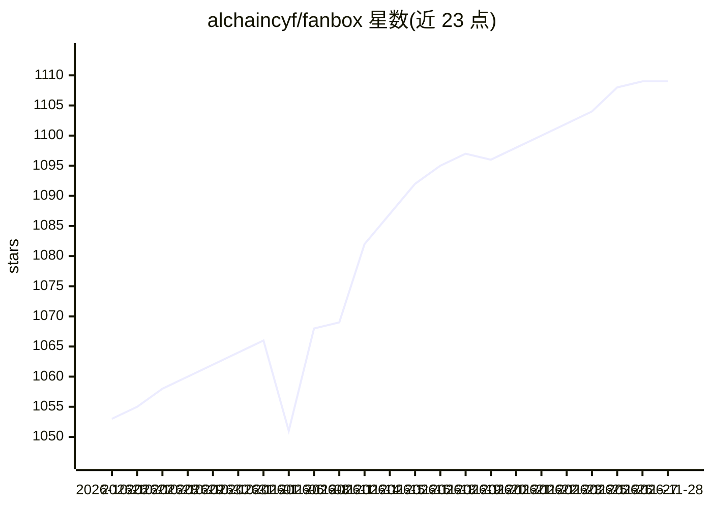

# alchaincyf/fanbox

⭐ 1,109 · JavaScript · MIT · 推送 2026-11-27 · [GitHub](https://github.com/alchaincyf/fanbox) · [官网](https://github.com/alchaincyf/fanbox/releases/latest) · 个人维护 · 中文 README

**给 vibe coding 用的本地驾驶舱：管文件、指挥 agent、看清改动**

Electron 桌面应用，把文件浏览、内嵌真实终端（node-pty + xterm.js）与 agent 改动追踪收进一个窗口。核心机制：为 Claude Code / Codex 挂官方 hooks 获得精确状态事件，agent 每写一个文件对应卡片亮起，提供回合级 diff、逐文件还原、整回合回滚与回放时间轴；diff 批注以 bracketed paste 回喂 agent 终端。三套皮肤，本地优先、零运行时依赖、不做云与账号。Windows 提供安装包，另有 dmg 下载。

## 筛选速览

| 维度 | 判定 | 备注 |
|---|---|---|
| AI 角色 | `ai-ecosystem` | LLM/agent 周边工具 |
| 许可风险 | `permissive` | MIT |
| 部署形态 | `desktop` | 安装包/桌面程序 |
| 模型依赖 | — | README 未给出锁定关系 |
| 硬件要求 | — | 无带数字的原话,不猜 |
| 安装摩擦 | `low` | 无编译、无系统依赖或容器化 |
| 成熟度 | — | 结构信号不足 |

## 能力要点

- 通过官方 hooks 精确感知 agent 状态（干活/等确认/等输入/完成）
- 回合级改动面板：逐文件 diff、单文件还原、整回合回滚与回放时间轴
- 13 个 agent 一键启动入口，~/.fanbox/config.json 可自定义
- 项目记忆：历史会话、改动文件、触发过的 skill 与一键 resume

## 适用场景

- 一个窗口内找回 AI 生成的项目、跑 agent、验收改动
- 多个 agent 会话并行时集中查看哪些在等我确认或输入
- Claude Code 断网/休眠中断后自动续跑
- 用 AI 元数据整理散乱的本地项目文件夹并一键撤销

## 场景标签

`AI 助手` · 领域:对话与助手

## 证据(README 行号)

> L14: **FanBox：Coding Agent 的驾驶舱。指挥 Claude Code、Codex 在本地干活，看清它碰过的每个文件、改过的每一行，随时接手。**
> L108: - **精确的态势感知 / Exact situational awareness** — FanBox 启动 Claude Code / Codex 时会挂上它们的官方 hooks（只叠加一份自己的 settings，不碰你的
> L41: No cloud, no remote, no accounts. Local-first, zero config, zero runtime dependencies.

## 星数曲线

2026-10-26 1,053 → 2026-11-28 1,109（+56）

---
*卡片 v1 · prompt 1.4 · 生成 2026-11-25 · 置信度 mid · 依据 README sha `1054e747b9f6` · [字段定义](../../DATASET.md)*
