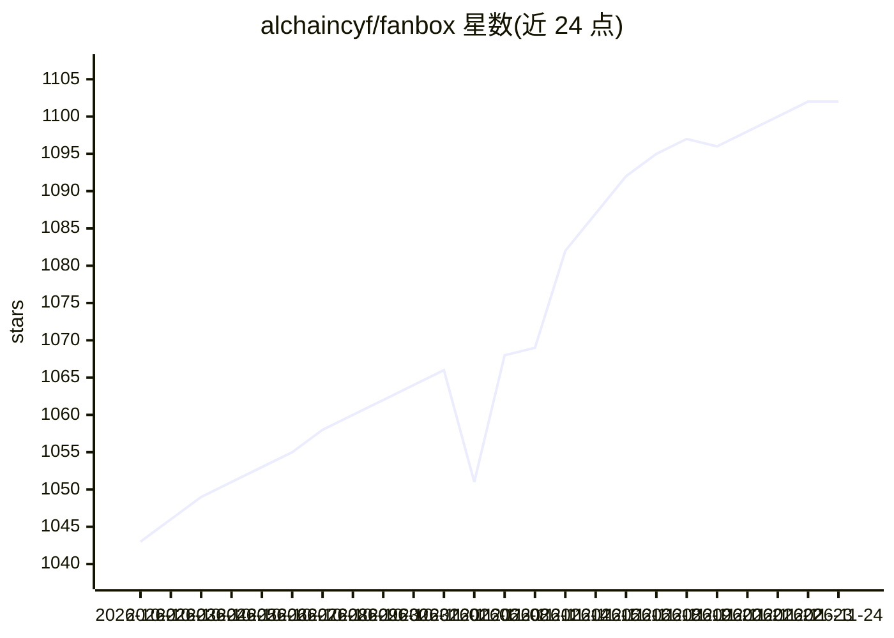

# alchaincyf/fanbox

⭐ 1,102 · JavaScript · MIT · 推送 2026-11-17 · [GitHub](https://github.com/alchaincyf/fanbox) · [官网](https://github.com/alchaincyf/fanbox/releases/latest) · 个人维护 · 中文 README

**给 vibe coding 用户的 Coding Agent 驾驶舱桌面应用**

基于 Electron 的本地优先桌面应用：左侧浏览/预览/编辑文件，右侧内嵌真实终端运行 Claude Code 等编码 agent，中间以卡片高亮、跟随模式、回合 diff 与回滚时间轴展示 agent 的每次文件改动。支持 11 个内置 agent 启动器、项目会话记忆与一键续跑、AI 元数据整理提案、agent 用量配额查看，提供 Windows 与 dmg 安装包。不做云与账号，零运行时依赖，定位是「找回项目 + 预览 + 轻改 + 指挥 agent」。

## 筛选速览

| 维度 | 判定 | 备注 |
|---|---|---|
| AI 角色 | `ai-ecosystem` | LLM/agent 周边工具 |
| 许可风险 | `permissive` | MIT |
| 部署形态 | `desktop` | 安装包/桌面程序 |
| 模型依赖 | — | README 未给出锁定关系 |
| 硬件要求 | — | 无带数字的原话,不猜 |
| 安装摩擦 | `low` | 无编译、无系统依赖或容器化 |
| 成熟度 | — | 结构信号不足 |

## 能力要点

- agent 每写一个文件对应卡片点亮，回合级 diff、逐文件还原与整回合回滚
- 11 个内置 agent 一键启动器（Claude Code、Codex、DeepSeek Harness 等）
- 通过官方 hooks 精确感知 agent 状态，断线自动续跑与跨窗口互通
- 项目记忆一键 `claude --resume`/`codex resume` 接续上下文

## 适用场景

- 一个下午用 AI 起了多个项目，需要找回并看清每个 agent 改了什么
- 在同一个窗口里浏览文件、预览效果并向终端 agent 下指令
- 管理多个 agent 会话，快速响应等待确认或输入的会话

## 场景标签

`编码 Agent` · 领域:编码与开发

## 证据(README 行号)

> L14: **FanBox：Coding Agent 的驾驶舱。指挥 Claude Code、Codex 在本地干活，看清它碰过的每个文件、改过的每一行，随时接手。**
> L116: - **11 个 agent 一键启动 / 11 built-in agent launchers** — Claude Code、Codex、DeepSeek Harness、Hermes Agent、OpenClaw、Kim

## 星数曲线

2026-10-22 1,043 → 2026-11-24 1,102（+59）

---
*卡片 v1 · prompt 1.4 · 生成 2026-11-24 · 置信度 mid · 依据 README sha `4f384fcac1c9` · [字段定义](../../DATASET.md)*
