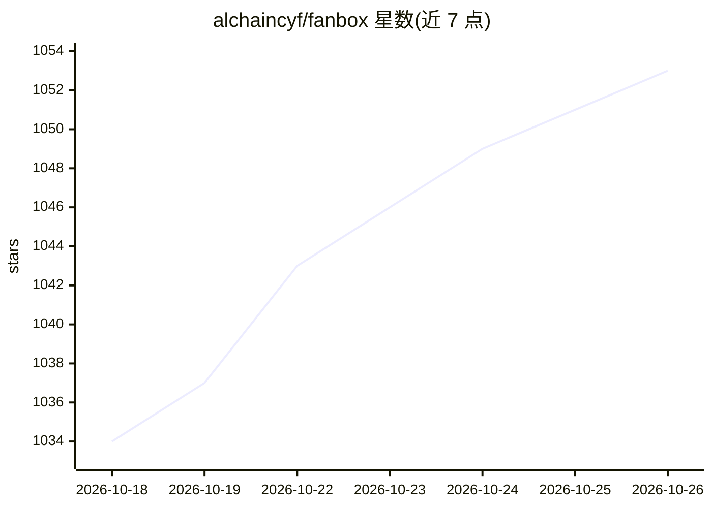

# alchaincyf/fanbox

⭐ 1,053 · JavaScript · MIT · 推送 2026-10-12 · [GitHub](https://github.com/alchaincyf/fanbox) · [官网](https://github.com/alchaincyf/fanbox/releases/latest) · 个人维护 · 中文 README

**给 vibe coding 的本地驾驶舱：文件浏览+内嵌终端+追踪 agent 改动**

基于 Electron 的 macOS 本地应用：左侧文件浏览与预览（Markdown/HTML/图片/PDF/压缩包），右侧内嵌真实终端（node-pty + xterm.js）运行 Claude Code、Codex 等 11 种 coding agent。核心机制是追踪 agent 的文件改动：卡片发光提示、跟随模式实时预览、按回合查看 diff 与回滚、diff 批注一键回喂终端；另含项目记忆（claude --resume/codex resume 续会话）、AI 整理提案（只读元数据）、agent 用量统计、Skills 透视。不做云与账号，本地零配置运行时零依赖。

## 筛选速览

| 维度 | 判定 | 备注 |
|---|---|---|
| AI 角色 | `ai-enhanced` | 去掉 AI 部分产品仍成立 |
| 许可风险 | `permissive` | MIT |
| 部署形态 | `desktop` | 安装包/桌面程序 |
| 模型依赖 | — | README 未给出锁定关系 |
| 硬件要求 | — | 无带数字的原话,不猜 |
| 安装摩擦 | `low` | 无编译、无系统依赖或容器化 |
| 成熟度 | — | 结构信号不足 |

## 能力要点

- 内嵌终端运行 11 种 coding agent（默认 Claude Code + Codex，可自定义）
- 按回合追踪 agent 文件改动：diff 并排对比、单文件还原、回放时间轴
- diff 批注以 bracketed paste 回喂 agent 终端，最终回车由用户执行
- 项目记忆：查看历史会话与改动文件，一键 claude --resume / codex resume 续接

## 适用场景

- AI 一口气起了多个项目后，在一个窗口里找回并看清每个项目被改了什么
- 多终端并行跑 agent，用指挥台快速跳到等待确认/输入的会话
- 在 diff 上写批注直接反馈给 agent 迭代代码

## 场景标签

`代码审查` · 领域:编码与开发

## 证据(README 行号)

> L14: **FanBox：Coding Agent 的驾驶舱。指挥 Claude Code、Codex 在本地干活，看清它碰过的每个文件、改过的每一行，随时接手。**
> L35: FanBox 把这条链路收进一个窗口：**左边文件 × 右边/下边终端 × 原地预览**，一个有机整体。它不跟 Finder 拼文件操作，不跟 VS Code 拼编辑，专注「找回 + 预览 + 轻改 + 指挥 agent」这一条链
> L41: No cloud, no remote, no accounts. Local-first, zero config, zero runtime dependencies.

## 星数曲线

2026-10-18 1,034 → 2026-10-26 1,053（+19）

---
*卡片 v1 · prompt 1.4 · 生成 2026-10-21 · 置信度 mid · 依据 README sha `a47288e74b67` · [字段定义](../../DATASET.md)*
