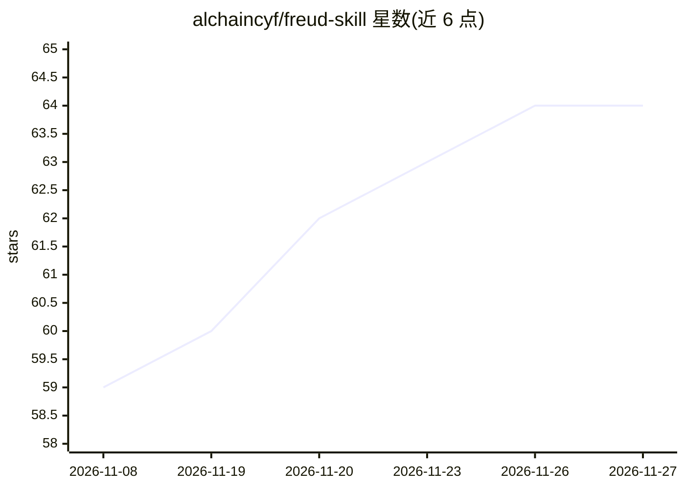

# alchaincyf/freud-skill

⭐ 64 · MIT · 推送 2026-10-13 · [GitHub](https://github.com/alchaincyf/freud-skill) · 个人维护 · 中文 README

**给 AI Agent 的心理分析式认知调优技能（SKILL）**

以 Anthropic 可解释性论文为依据的 prompt 工程方法，打包为 Agent Skills 标准（SKILL.md）技能：通过 git clone 放入 skills 目录后，在 Claude Code / Codex / Cursor / OpenClaw 等运行时中按触发词自动调用。提供两种模式——执行增强（重要任务前建立身份/信念/品味锚点并做一致性检查与情绪校准）和诊断优化（对 prompt/skill 做六镜头扫描并给出 before/after 重写）。核心是六条原理，如正面定义胜过否定规则、工作空间容量约 25 概念需外化扩容等，附论文对照表。

## 筛选速览

| 维度 | 判定 | 备注 |
|---|---|---|
| AI 角色 | `ai-knowledge` | 知识聚合/清单类 |
| 许可风险 | `permissive` | MIT |
| 部署形态 | `None` |  |
| 模型依赖 | — | README 未给出锁定关系 |
| 硬件要求 | — | 无带数字的原话,不猜 |
| 安装摩擦 | `low` | 无编译、无系统依赖或容器化 |
| 成熟度 | — | 结构信号不足 |

## 能力要点

- 两种模式：执行前认知准备与 prompt/skill 诊断重写
- 六条核心原理，均标注 Anthropic 论文出处（Persona Vectors 等）
- 兼容 Claude Code / Codex / Cursor / OpenClaw 等支持 Agent Skills 标准的运行时
- 按触发词自动调用（如「优化这个 prompt」「弗洛伊德」）

## 适用场景

- 重要任务前给 AI 做认知状态准备
- 诊断并重写存在身份冲突、规则堆砌、隐含矛盾的 prompt/skill
- 学习将可解释性研究转成 prompt 工程方法

## 场景标签

`提示工程` · 领域:Agent 开发

## 证据(README 行号)

> L26: - **执行前**做认知准备——像心理咨询师让来访者进入最佳状态再开始；
> L43: |**诊断优化**|提交 prompt/skill 求优化|先做 30 秒健康体检 → 六镜头扫描 → 诊断-确认-重写三段式，给 before/after|
> L54: 兼容 Claude Code / Codex / Cursor / OpenClaw 等支持 Agent Skills 标准的运行时。安装后，当你说「优化这个 prompt」「输出不够好」「给 AI 看心理医生」「弗洛伊德」时自动

## 星数曲线

2026-11-08 59 → 2026-11-27 64（+5）

---
*卡片 v1 · prompt 1.4 · 生成 2026-11-18 · 置信度 mid · 依据 README sha `cc5e59daaf54` · [字段定义](../../DATASET.md)*
