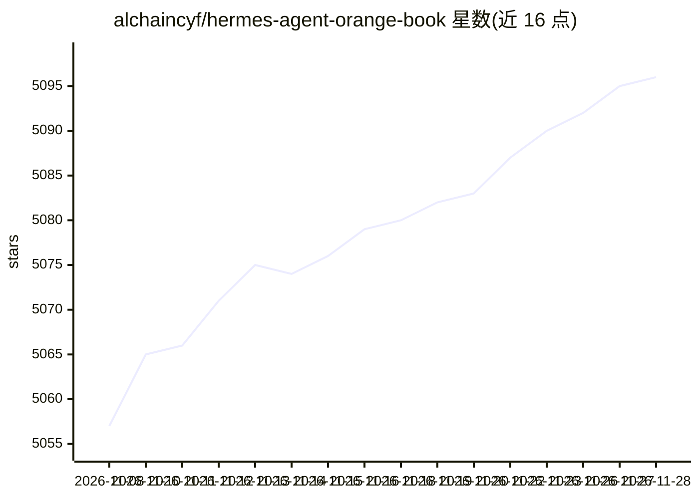

# alchaincyf/hermes-agent-orange-book

⭐ 5,096 · Python · NOASSERTION · 推送 2026-10-20 · [GitHub](https://github.com/alchaincyf/hermes-agent-orange-book) · 个人维护 · 中文 README

**Hermes Agent 开源框架的实战教程电子书（橙皮书系列）**

由花叔（HuaShu）撰写的免费电子书，系统讲解 Nous Research 开源 AI Agent 框架 Hermes Agent。中文第三版（v261020）基于 Hermes v0.22.2 重写，含 21 节 6 部分，覆盖自我改进循环、三层记忆、Skills、64 个工具、MCP、23 个消息平台、多代理看板与安全模型，并附 40 张实机截图与动手章节。同时发布英文第二版。README 含勘误节，修正了初版关于数据收集的推断错误。以 PDF 与在线阅读形式提供，MIT 许可。

## 筛选速览

| 维度 | 判定 | 备注 |
|---|---|---|
| AI 角色 | `ai-knowledge` | 知识聚合/清单类 |
| 许可风险 | `none` | NOASSERTION |
| 部署形态 | `None` |  |
| 模型依赖 | — | README 未给出锁定关系 |
| 硬件要求 | — | 无带数字的原话,不猜 |
| 安装摩擦 | `low` | 无编译、无系统依赖或容器化 |
| 成熟度 | — | 结构信号不足 |

## 能力要点

- 21 节 6 部分覆盖自我改进、记忆、工具、多代理编排与安全模型
- 中文第三版基于 Hermes v0.22.2，含新动手章节与 40 张实机截图
- 含公开勘误节，修正初版对数据收集机制的错误推断
- 2.0 起许可从 CC BY-NC-SA 4.0 改为 MIT

## 适用场景

- 系统学习 Hermes Agent 框架的架构与使用
- 从 Claude Code / OpenClaw / Cursor 转向了解 Hermes 的开发者入门
- 了解自我改进 Agent 与 Harness Engineering 落地思路

## 场景标签

`教程课程` · 领域:学习与行业

## 证据(README 行号)

> L11: A hands-on guide to Hermes Agent, the open-source AI Agent framework by Nous Research — the first agent that ships 
> L45: **21 sections across 6 parts:**

## 星数曲线

2026-11-08 5,057 → 2026-11-28 5,096（+39）

---
*卡片 v1 · prompt 1.4 · 生成 2026-11-17 · 置信度 high · 依据 README sha `7b72b546636a` · [字段定义](../../DATASET.md)*
