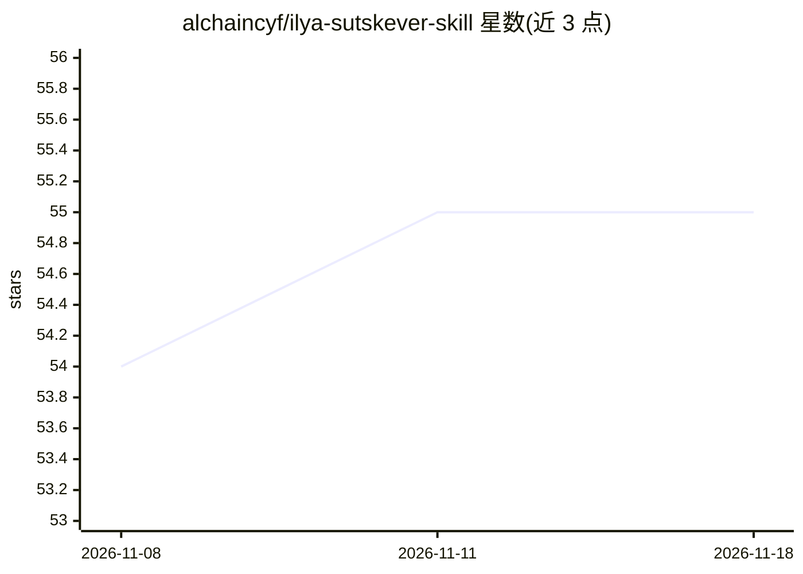

# alchaincyf/ilya-sutskever-skill

⭐ 55 · MIT · 推送 2026-10-13 · [GitHub](https://github.com/alchaincyf/ilya-sutskever-skill) · 个人维护 · 中文 README

**Ilya Sutskever 认知风格 agent 技能：让 AI 用其思维框架分析问题**

一个基于开放 Agent Skills 协议的 SKILL.md 人物技能：由「女娲.skill」基于 12 段一手对话、9 篇论文、10 小时宣誓证词等调研蒸馏出 6 个心智模型、8 条决策启发式与表达 DNA，使兼容 runtime 中的 agent 以该认知框架回应问题。通过 npx skills 安装器或手动 clone 到 50+ runtime（Claude Code、Codex、Cursor 等）的 skills 目录；不支持加载的 runtime 可直接粘贴 markdown 使用。仓库附 2027 行调研来源文件与示例对话，MIT 许可。

## 筛选速览

| 维度 | 判定 | 备注 |
|---|---|---|
| AI 角色 | `ai-knowledge` | 知识聚合/清单类 |
| 许可风险 | `permissive` | MIT |
| 部署形态 | `library` | 以包/库形式分发 |
| 模型依赖 | — | README 未给出锁定关系 |
| 硬件要求 | — | 无带数字的原话,不猜 |
| 安装摩擦 | `low` | 无编译、无系统依赖或容器化 |
| 成熟度 | — | 结构信号不足 |

## 能力要点

- 单文件 SKILL.md（markdown + YAML frontmatter），兼容 50+ agent runtime
- 调研来源含 6 个文件共 2027 行（一手/二手来源分列）
- 提供 npx skills add 一行安装与各 runtime 手动路径表
- 由女娲.skill 自动生成，可按名字蒸馏其他人物

## 适用场景

- 让我的 coding agent 用 Ilya 的心智模型分析研究方向
- 以特定人物视角讨论 scaling、AI 安全等话题
- 作为参考资料粘贴到任意对话中参考其决策启发式

## 场景标签

`提示工程` · 领域:Agent 开发

## 证据(README 行号)

> L54: 本 skill 基于开放的 Agent Skills 协议，可在任何 skills-compatible 的 AI agent runtime 中运行（Claude Code、Codex、Cursor、OpenClaw、Herme
> L138: 6个调研文件，共2027行，全部在 `references/research/` 目录：
> L161: 由 女娲.skill 自动生成。

## 星数曲线

2026-11-08 54 → 2026-11-18 55（+1）

---
*卡片 v1 · prompt 1.4 · 生成 2026-11-18 · 置信度 high · 依据 README sha `68420f7cfb59` · [字段定义](../../DATASET.md)*
