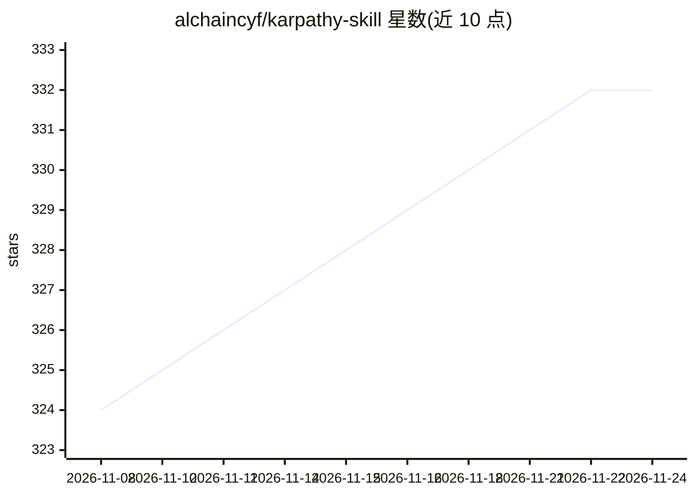

# alchaincyf/karpathy-skill

⭐ 332 · MIT · 推送 2026-11-15 · [GitHub](https://github.com/alchaincyf/karpathy-skill) · 个人维护 · 中文 README

**Andrej Karpathy 认知框架的 Agent Skill：让 AI 用其思维模型回答问题**

基于 Agent Skills 协议的 SKILL.md 技能包，由女娲.skill 自动生成：调研 Karpathy 的 20+ 篇博文、16 段访谈、100+ 条 X 帖子等来源，提炼 6 个心智模型、8 条决策启发式与表达风格 DNA。安装到 Claude Code、Codex、Cursor、Gemini CLI 等 50+ 兼容 runtime 后，用户可用其视角提问并获得分析。非官方项目，未获本人授权，示例均为 AI 生成；附 6 个调研来源文件（1457 行）。

## 筛选速览

| 维度 | 判定 | 备注 |
|---|---|---|
| AI 角色 | `ai-knowledge` | 知识聚合/清单类 |
| 许可风险 | `permissive` | MIT |
| 部署形态 | `library` | 以包/库形式分发 |
| 模型依赖 | — | README 未给出锁定关系 |
| 硬件要求 | — | 无带数字的原话,不猜 |
| 安装摩擦 | `low` | 无编译、无系统依赖或容器化 |
| 成熟度 | — | 结构信号不足 |

## 能力要点

- 提炼 6 个心智模型与 8 条决策启发式，附来源标注
- 基于开放 Agent Skills 协议，兼容 50+ agent runtime
- 提供 npx 一行命令安装与手动安装两种方式
- 附 references/research/ 目录下 6 个调研文件（1457 行）

## 适用场景

- 让 coding agent 用 Karpathy 的认知框架评估技术决策
- 以特定视角讨论 vibe coding、学习方法等话题
- 作为参考资料粘贴进任意对话使用

## 场景标签

 · 领域:AI agent 技能/知识内容

## 证据(README 行号)

> L57: 本 skill 基于开放的 Agent Skills 协议，可在任何 skills-compatible 的 AI agent runtime 中运行（Claude Code、Codex、Cursor、OpenClaw、Herme
> L178: ├── SKILL.md                              # 可直接安装使用

## 星数曲线

2026-11-08 324 → 2026-11-24 332（+8）

---
*卡片 v1 · prompt 1.4 · 生成 2026-11-17 · 置信度 high · 依据 README sha `dbe2a1dfc509` · [字段定义](../../DATASET.md)*
