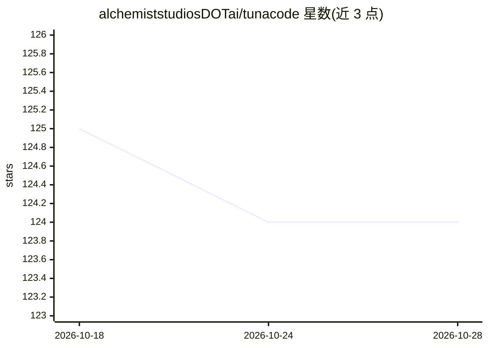

# alchemiststudiosDOTai/tunacode

⭐ 124 · Python · MIT · 推送 2026-10-05 · [GitHub](https://github.com/alchemiststudiosDOTai/tunacode) · [官网](https://tunacode.xyz) · 组织维护

**终端 AI 编程 agent，多 LLM 支持与文件/命令工具**

基于 Textual/Rich 的终端 AI 编程助手，提供 NeXTSTEP 风格可主题化界面。核心 agent 循环由 tinyAgent 驱动，可连接任意 OpenAI 兼容 API，也支持 Anthropic API key 配置。内置 bash 执行、哈希校验的文件读写编辑、自然语言仓库搜索（discover）、网页抓取等工具，支持会话持久化与上下文压缩。README 自述为早期软件、非生产就绪，且 shell 访问无权限提示，需用户自行用 git 回滚或在容器中运行。

## 筛选速览

| 维度 | 判定 | 备注 |
|---|---|---|
| AI 角色 | `ai-ecosystem` | LLM/agent 周边工具 |
| 许可风险 | `permissive` | MIT |
| 部署形态 | `library` | 以包/库形式分发 |
| 模型依赖 | — | README 未给出锁定关系 |
| 硬件要求 | — | 无带数字的原话,不猜 |
| 安装摩擦 | `medium` | 含编译或系统依赖之一 |
| 成熟度 | `idea` | |

## 能力要点

- 兼容任意 OpenAI 兼容 API，支持 Anthropic/OpenAI key
- 哈希校验的 read_file/hashline_edit 文件编辑机制
- bash 执行、discover 自然语言仓库搜索、web_fetch 工具
- 会话持久化（/resume）、上下文压缩（/compact）、CSS 主题 UI

## 适用场景

- 在终端中通过对话完成代码编辑与命令执行
- 自然语言搜索和探索代码仓库
- 中断后恢复之前的编程会话继续工作

## 场景标签

`编码 Agent` · 领域:编码与开发

## 证据(README 行号)

> L11: A terminal-based AI coding agent with a NeXTSTEP-inspired interface.
> L17: - **Any model** - Works with any OpenAI-compatible API

## 星数曲线

2026-10-18 125 → 2026-10-28 124（-1）

---
*卡片 v1 · prompt 1.4 · 生成 2026-10-23 · 置信度 high · 依据 README sha `4c6c7cb439be` · [字段定义](../../DATASET.md)*
