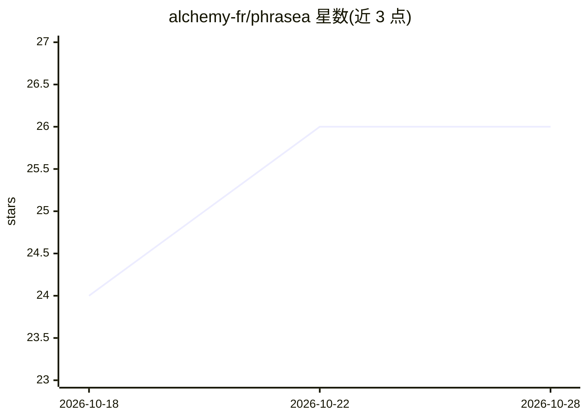

# alchemy-fr/phrasea

⭐ 26 · PHP · MIT · 推送 2026-10-27 · [GitHub](https://github.com/alchemy-fr/phrasea) · [官网](https://phrasea.com) · 组织维护

**面向组织机构的开源数字资产管理（DAM）平台**

由 Alchemy 开发（Phraseanet 后继）的开源 DAM 平台，包含 Databox（核心 DAM：工作区、集合、元数据、renditions、协作）、基于 Elasticsearch 的搜索与 AQL 查询语言、Expose（资产网络发布）、Uploader（多方式上传与交付）和 Dashboard 五个应用。每应用为 Symfony API 加 React 客户端，经 RabbitMQ 走 Symfony Messenger 处理长任务。AI 能力以工作流集成形式提供（AWS Rekognition/Transcribe/Translate、Happyscribe 等）。支持 Docker Compose 或 Kubernetes/Helm 部署，可 SaaS、本地或混合运行；本地快速启动需 Linux、Docker、约 6 核 16GB 内存与 mkcert。

## 筛选速览

| 维度 | 判定 | 备注 |
|---|---|---|
| AI 角色 | `ai-enhanced` | 去掉 AI 部分产品仍成立 |
| 许可风险 | `permissive` | MIT |
| 部署形态 | `desktop` | 安装包/桌面程序 |
| 模型依赖 | — | README 未给出锁定关系 |
| 硬件要求 | — | 无带数字的原话,不猜 |
| 安装摩擦 | `low` | 无编译、无系统依赖或容器化 |
| 成熟度 | — | 结构信号不足 |

## 能力要点

- Databox/Expose/Uploader/Dashboard 多应用架构，细粒度权限控制
- Elasticsearch 全文搜索与 AQL 资产查询语言，支持地图布局
- 工作流集成 AWS Rekognition/Transcribe/Translate、Happyscribe 等 AI 服务
- Docker Compose 与 Kubernetes/Helm 两种部署方式，镜像发布于 Docker Hub

## 适用场景

- 组织集中管理数字资产并控制用户/组权限
- 向外部发布资产画廊并设置密码或认证保护
- 通过 URL、拖拽、剪贴板批量上传并按 JSON Schema 表单录入元数据
- 在摄取工作流中自动转录、翻译或打标资产

## 场景标签

 · 领域:数字资产管理/企业内容平台

## 证据(README 行号)

> L16: Phrasea is an open-source Digital Asset Management (DAM) platform for organizations that need
> L63: - AWS Rekognition, AWS Transcribe, AWS Translate

## 星数曲线

2026-10-18 24 → 2026-10-28 26（+2）

---
*卡片 v1 · prompt 1.4 · 生成 2026-10-26 · 置信度 high · 依据 README sha `b5b106984bd6` · [字段定义](../../DATASET.md)*
