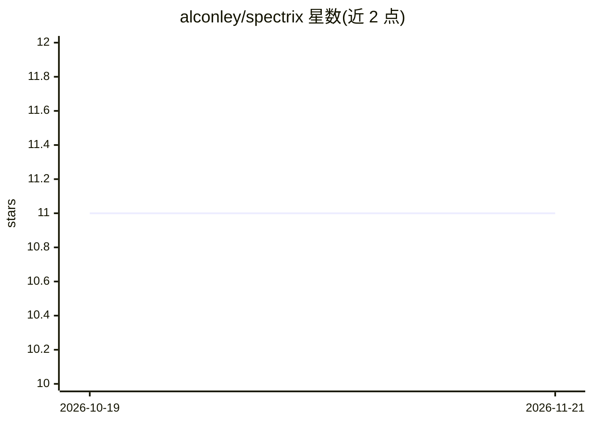

# alconley/spectrix

⭐ 11 · Rust · NOASSERTION · 推送 2026-09-09 · [GitHub](https://github.com/alconley/spectrix) · 个人维护

**面向核物理实验数据的 AI 辅助谱分析与可视化工具**

用 Rust（egui/egui_plot/polars）构建的桌面谱分析工具，读取 .parquet 与 .root 事件数据，提供 1D/2D 直方图、交互式切分（cuts）、派生列计算、校准变换与基于 Python lmfit 的高斯拟合。通过 uproot 在后台读取 ROOT 直方图而不阻塞 UI。内置 Spectrix AI 助手回答基于来源的使用问题、UI 操作帮助与事件数据解释（README 标注该功能仍在开发中）。安装需从源码编译（Rust stable + Python 3.13），提供 spectrix.sh 一键脚本与各平台系统依赖说明。

## 筛选速览

| 维度 | 判定 | 备注 |
|---|---|---|
| AI 角色 | `ai-enhanced` | 去掉 AI 部分产品仍成立 |
| 许可风险 | `none` | NOASSERTION |
| 部署形态 | `library` | 以包/库形式分发 |
| 模型依赖 | — | README 未给出锁定关系 |
| 硬件要求 | — | 无带数字的原话,不猜 |
| 安装摩擦 | `low` | 无编译、无系统依赖或容器化 |
| 成熟度 | `idea` | |

## 能力要点

- 读取 .parquet 与 .root 文件，ROOT 直方图后台检索不阻塞 UI
- 直方图脚本系统：变量、列组、派生列、校准表、1D/2D 切分，配置可存为 JSON 复用
- 基于 Python lmfit 的高斯拟合（含总拟合不确定度带）
- Spectrix AI 助手提供来源依据的使用问答与事件数据解释（开发中）

## 适用场景

- 核物理实验（如 (d,pγ) 反应）产生的 parquet/ROOT 事件数据做直方图与峰拟合
- 交互式定义切分并导出过滤后的 parquet 子集
- 跨多个 ROOT 文件合并或按前缀分别加载同名直方图

## 场景标签

`数据分析` · 领域:效率与自动化

## 证据(README 行号)

> L3: **Spectrix** is an **AI-assisted spectrum analysis** and experimental event based-data exploration tool. It provides
> L28: - Spectrix AI assistant for source-grounded usage questions, UI workflow help, and event-data explanations

## 星数曲线

2026-10-19 11 → 2026-11-21 11（+0）

---
*卡片 v1 · prompt 1.4 · 生成 2026-11-18 · 置信度 high · 依据 README sha `7f590e017999` · [字段定义](../../DATASET.md)*
