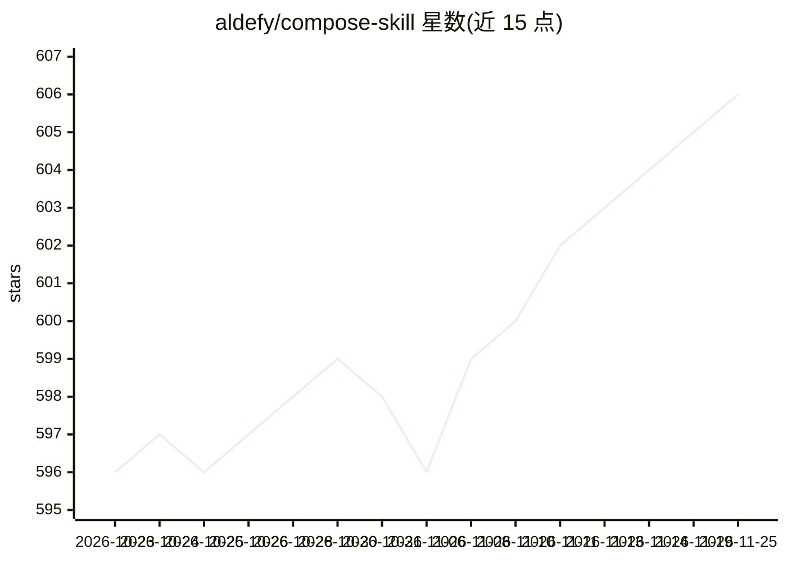

# aldefy/compose-skill

⭐ 606 · Python · NOASSERTION · 推送 2026-11-07 · [GitHub](https://github.com/aldefy/compose-skill) · 个人维护

**为 AI 编码工具注入 Compose 源码级参考知识的技能包**

以 markdown 技能包形式分发的 Jetpack Compose 编码指导资源：包含 35 份主题参考文档（状态管理、导航、动画、多平台、TV/Wear/XR 等）与 6 份取自 androidx/androidx 与 compose-multiplatform-core 的 Kotlin 源码文件，供 agent 在回答 Compose 相关问题时读取核验。提供 Claude Code 插件市场安装及 Codex CLI、Gemini CLI、Cursor、Copilot 等工具的目录复制或规则文件配置方式，通过 GitHub Releases 发布更新。

## 筛选速览

| 维度 | 判定 | 备注 |
|---|---|---|
| AI 角色 | `ai-knowledge` | 知识聚合/清单类 |
| 许可风险 | `none` | NOASSERTION |
| 部署形态 | `None` |  |
| 模型依赖 | — | README 未给出锁定关系 |
| 硬件要求 | — | 无带数字的原话,不猜 |
| 安装摩擦 | `low` | 无编译、无系统依赖或容器化 |
| 成熟度 | — | 结构信号不足 |

## 能力要点

- 35 份覆盖 Compose 主要主题的参考文档，含 Quick Routing 任务路由
- 6 份直接取自 androidx 与 compose-multiplatform-core 的源码文件供 agent 核验
- 支持 Claude Code 插件市场安装及多工具（Codex/Gemini CLI/Cursor/Copilot/Antigravity）配置
- 以 GitHub Releases 发布版本并附迁移说明

## 适用场景

- 让 AI 编码助手按 Compose 正确模式生成状态、导航与副作用代码
- 团队在项目中统一 Compose 编码规范供 agent 遵循
- 跨 Android/Desktop/iOS/Web 多平台 Compose 开发时提供参考

## 场景标签

`代码生成` · 领域:编码与开发

## 证据(README 行号)

> L84: 1. **35 reference guides** covering every major Compose topic — including Compose Multiplatform, A2UI, AppState, Re
> L145: **Layer 1: guidance docs** (35 files) — practical references with patterns, pitfalls, and do/don't examples. The s
> L160: The skill is just markdown files. Every tool below reads the same content. Pick yours.

## 星数曲线

2026-10-23 596 → 2026-11-25 606（+10）

---
*卡片 v1 · prompt 1.4 · 生成 2026-11-25 · 置信度 high · 依据 README sha `ef957080bcf5` · [字段定义](../../DATASET.md)*
