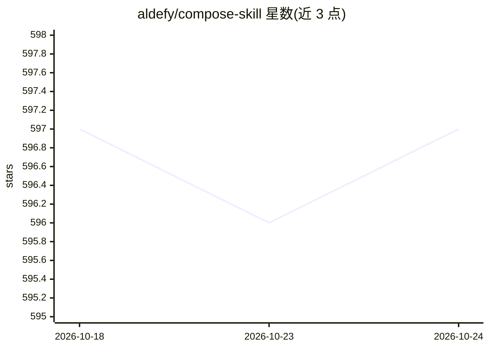

# aldefy/compose-skill

⭐ 596 · Kotlin · NOASSERTION · 推送 2026-07-23 · [GitHub](https://github.com/aldefy/compose-skill) · 组织维护

**给 AI 编码工具的 Jetpack Compose 知识技能包**

面向 AI 编码助手（Claude Code、Codex CLI、Gemini CLI、Cursor、Copilot、Windsurf 等）的 Jetpack Compose 技能插件：以纯 markdown 文件形式提供 24 篇参考指南与 6 个取自 androidx/androidx 和 compose-multiplatform-core 的源码文件，使代理在生成 Compose 代码时可查阅状态管理、性能、导航、动画、多平台等主题的规范并核验实现细节，而非凭猜测输出。安装方式为克隆仓库复制到各工具的技能/规则目录，或通过插件命令安装。

## 筛选速览

| 维度 | 判定 | 备注 |
|---|---|---|
| AI 角色 | `ai-ecosystem` | LLM/agent 周边工具 |
| 许可风险 | `none` | NOASSERTION |
| 部署形态 | `None` |  |
| 模型依赖 | locked-api |  |
| 硬件要求 | — | 无带数字的原话,不猜 |
| 安装摩擦 | `low` | 无编译、无系统依赖或容器化 |
| 成熟度 | — | 结构信号不足 |

## 能力要点

- 24 篇覆盖 Compose 各主题的参考指南（含 Multiplatform、TV、M3 Motion、Paging 3、Nav 3 迁移）
- 6 个来自 androidx/androidx 与 compose-multiplatform-core 的源码文件供代理核验实现
- 支持 Claude Code、Codex CLI、Gemini CLI、Cursor、Copilot、Windsurf、Amazon Q 等多种 AI 编码工具
- 纯 markdown 形式，通过 SKILL.md 工作流与 Quick Routing 按任务信号定位参考文件

## 适用场景

- 让 Claude Code/Copilot 等 AI 编码工具生成更符合 Compose 规范的代码
- 查阅类型安全导航、Nav 2→Nav 3 迁移、Paging 3 等主题的参考指南
- 对照 androidx 实际源码核验 AI 建议的 API 行为

## 场景标签

 · 领域:软件开发/移动端（Android）

## 证据(README 行号)

> L103: The skill is just markdown files. Every tool below reads the same content. Pick yours.
> L243: It's just markdown. Clone this repo into your project (or add as a submodule), then point your tool's instruction 

## 星数曲线

2026-10-18 597 → 2026-10-24 597（+0）

---
*卡片 v1 · prompt 1.4 · 生成 2026-10-21 · 置信度 high · 依据 README sha `038c0941dc4e` · [字段定义](../../DATASET.md)*
