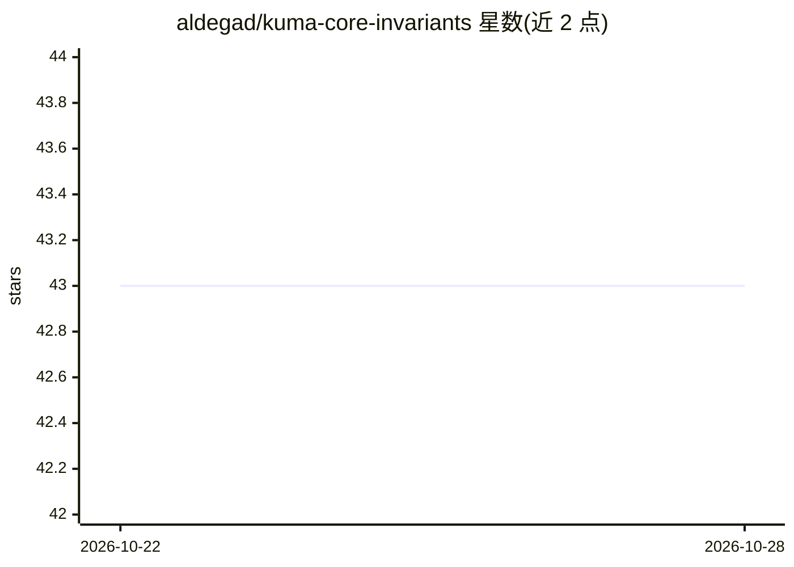

# aldegad/kuma-core-invariants

⭐ 43 · JavaScript · MIT · 推送 2026-10-20 · [GitHub](https://github.com/aldegad/kuma-core-invariants) · [官网](https://github.com/aldegad/alex-core-invariants) · 个人维护

**AI 辅助工程的八条工程不变式规范库，供其他仓库引用**

一个 canonical 政策仓库：定义 AI 辅助工程需遵守的八条不变式（SSoT、SoC/SRP、一致性、原子性、幂等、禁止静默回退、文档/计划先行、隔离），不变式正文仅存于 README.md，其他仓库以链接方式引用而非复制。附韩语派生翻译（以 source-sha 头钉定版本）、SKILL.md 代理工作流、checks/ 目录下的启发式扫描脚本（policy-scan.mjs，用于在别的代码库中标记疑似违规项供人工复核）、翻译盖章脚本与可选 git pre-commit 钩子。MIT 许可。

## 筛选速览

| 维度 | 判定 | 备注 |
|---|---|---|
| AI 角色 | `ai-knowledge` | 知识聚合/清单类 |
| 许可风险 | `permissive` | MIT |
| 部署形态 | `None` |  |
| 模型依赖 | — | README 未给出锁定关系 |
| 硬件要求 | — | 无带数字的原话,不猜 |
| 安装摩擦 | `low` | 无编译、无系统依赖或容器化 |
| 成熟度 | — | 结构信号不足 |

## 能力要点

- 八条不变式的唯一权威文本存放于 README.md，其他仓库链接引用
- policy-scan.mjs 对外部代码库做启发式违规扫描，输出复核候选
- 韩语翻译通过 source-sha 与主文档同步，pre-commit 钩子拦截失步提交
- 提供 SKILL.md 代理工作流与 examples/AGENTS.md 落地示例

## 适用场景

- 为团队的 AI 辅助开发流程引用统一的工程规范文本
- 用 policy-scan 扫描代码库找出疑似违反不变式的位置
- 作为 agent（Codex 类技能）工作流中的规范依据

## 场景标签

`提示工程` · 领域:Agent 开发

## 证据(README 行号)

> L65: `kuma-core-invariants` is a small canonical policy repo for AI-assisted engineering: the invariant text lives in on
> L71: - `SKILL.md`: agent workflow that defers to `README.md`

## 星数曲线

2026-10-22 43 → 2026-10-28 43（+0）

---
*卡片 v1 · prompt 1.4 · 生成 2026-10-25 · 置信度 high · 依据 README sha `e40d8ace341d` · [字段定义](../../DATASET.md)*
