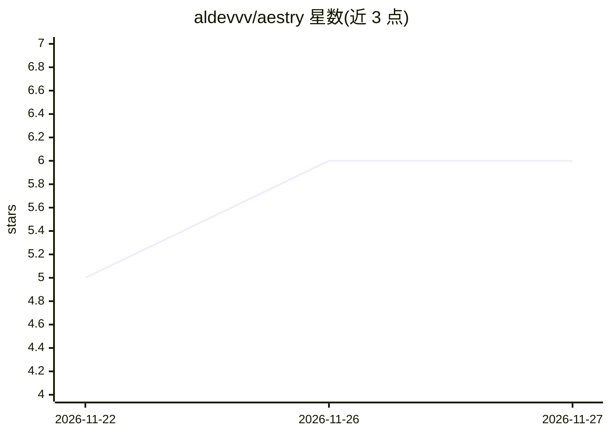

# aldevvv/aestry

⭐ 6 · TypeScript · 推送 2026-11-21 · [GitHub](https://github.com/aldevvv/aestry) · [官网](https://mhdalif.id/projects/aestry) · 个人维护

**给开发者本地生成应用图标、Logo 和 OG 图片的自托管 AI 工作室**

基于 Next.js 16/React 19 的自托管 Web 应用，以对话优先方式产出应用图标、项目 Logo 与 OG 图片：多模态咨询模型与用户讨论并分析参考图，生成经用户批准的 design brief 后由图像生成模型出图。密钥仅存服务端环境变量，支持 Google Gemini API 与 Vertex AI 两种通道，模型列表从 provider 动态加载。数据存于浏览器 IndexedDB，支持项目上下文、临时会话与访问口令保护。

## 筛选速览

| 维度 | 判定 | 备注 |
|---|---|---|
| AI 角色 | `ai-native` | 本体是模型或模型工具 |
| 许可风险 | `none` | — |
| 部署形态 | `library` | 以包/库形式分发 |
| 模型依赖 | — | README 未给出锁定关系 |
| 硬件要求 | — | 无带数字的原话,不猜 |
| 安装摩擦 | `low` | 无编译、无系统依赖或容器化 |
| 成熟度 | — | 结构信号不足 |

## 能力要点

- 对话式咨询 + 明确批准后才生成的两段式工作流
- BYOK：API key 仅存服务端，浏览器不接触密钥
- Gemini API 与 Vertex AI 双通道，可混用 provider 填充两种模型角色
- 资源类型内建为 App Icon/Logo/OG Image 三种 skill，提示词服务端编译

## 适用场景

- 为开源项目批量产出图标、Logo 和社交分享卡片
- 通过参考图与对话迭代打磨视觉资产的细节
- 本地自托管环境下管理生成密钥与访问权限

## 场景标签

`图像生成` · 领域:内容生成

## 证据(README 行号)

> L9: Aestry is conversation-first, not prompt-to-image. You describe what you want, a **multimodal model** consults with 
> L23: - **Image generation model**: produces the assets when you approve a brief.
> L41: - **Google Gemini Developer API** — `GOOGLE_API_KEY` (a Google AI Studio key), built on the official `@google/genai

## 星数曲线

2026-11-22 5 → 2026-11-27 6（+1）

---
*卡片 v1 · prompt 1.4 · 生成 2026-11-22 · 置信度 mid · 依据 README sha `a0c52cec4d0f` · [字段定义](../../DATASET.md)*
