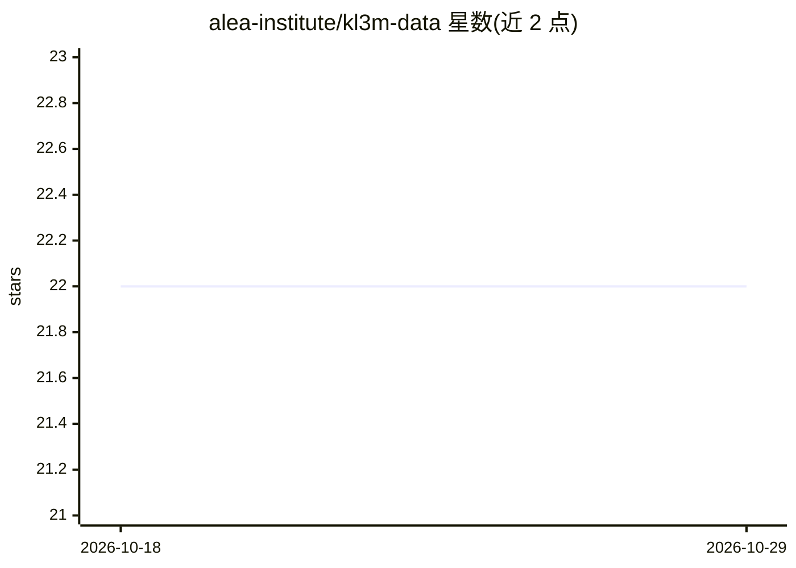

# alea-institute/kl3m-data

⭐ 22 · Python · MIT · 推送 2026-09-29 · [GitHub](https://github.com/alea-institute/kl3m-data) · [官网](https://aleainstitute.ai/data/) · 组织维护

**KL3M 模型的版权清洁训练数据采集与预处理源码库**

ALEA 研究所维护的 KL3M 训练数据工程：提供从 PACER/RECAP、SEC EDGAR、eCFR、USPTO 专利、欧盟官方公报、英国立法等公共来源采集文档的完整源码，并进行抽取、转换与预分词的多阶段处理；数据集覆盖 1.32 亿以上文档、数万亿 token，来源为可验证的公有领域或已获许可内容。数据经 Hugging Face、S3 与项目网站发布。代码以 MIT 许可，通过 git clone 加 Poetry 安装。

## 筛选速览

| 维度 | 判定 | 备注 |
|---|---|---|
| AI 角色 | `ai-ecosystem` | LLM/agent 周边工具 |
| 许可风险 | `permissive` | MIT |
| 部署形态 | `None` |  |
| 模型依赖 | — | README 未给出锁定关系 |
| 硬件要求 | — | 无带数字的原话,不猜 |
| 安装摩擦 | `low` | 无编译、无系统依赖或容器化 |
| 成熟度 | — | 结构信号不足 |

## 能力要点

- 覆盖 1.32 亿以上文档、数万亿 token 的数据集
- 来源均为可验证公有领域或已适当授权内容
- 提供文档采集与预处理的完整源码，覆盖美/欧/英/德多辖区公共数据源
- 多阶段数据形态：原始格式、抽取内容与预分词表示

## 适用场景

- 为 LLM 训练寻找法律风险较低的语料来源
- 复现或扩展公共法律/政府文档的采集与预处理流程
- 通过 Hugging Face 或 S3 直接获取 KL3M 数据快照

## 场景标签

`模型训练` `文档解析` · 领域:知识与检索

## 证据(README 行号)

> L8: This ALEA project contains the complete source code to collect and preprocess
> L10: provides a comprehensive, copyright-clean dataset for training large language models, addressing legal risks in

## 星数曲线

2026-10-18 22 → 2026-10-29 22（+0）

---
*卡片 v1 · prompt 1.4 · 生成 2026-10-27 · 置信度 high · 依据 README sha `730c9c6e5875` · [字段定义](../../DATASET.md)*
