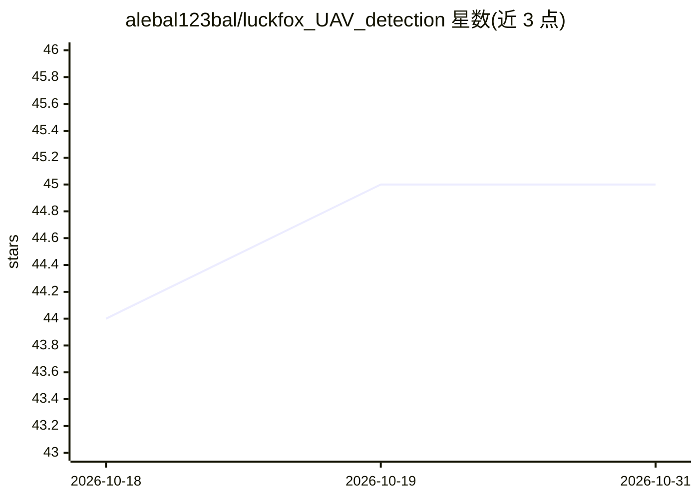

# alebal123bal/luckfox_UAV_detection

⭐ 45 · C++ · GPL-3.0 · 推送 2026-03-22 · [GitHub](https://github.com/alebal123bal/luckfox_UAV_detection) · 个人维护

**Luckfox Pico 嵌入式板上的实时无人机检测系统**

在 Luckfox Pico Pro/Max（Rockchip RV1106）开发板上运行的实时 UAV 检测系统：YOLOv5 模型经 RKNN 转换后由 NPU 推理，图像预处理（色彩转换、缩放、letterbox）全部使用 RV1106 硬件 RGA 单元与零拷贝 DMA 缓冲，替代 OpenCV CPU 路径，实现 30 FPS RTSP 流媒体与约 25-30ms 延迟；检测结果经 UART 以 MAVLink 协议（自定义消息 ID 9000）输出，兼容 Mission Planner、QGroundControl。另集成 PicoClaw 轻量 AI 助手（<10MB RAM），读取检测日志计算无人机轨迹并通过 Telegram 回复，需 SSH 反向隧道联网与 DeepSeek API key。需交叉编译工具链构建后部署到板端。README 声明仅限教育与研究用途。

## 筛选速览

| 维度 | 判定 | 备注 |
|---|---|---|
| AI 角色 | `ai-native` | 本体是模型或模型工具 |
| 许可风险 | `viral` | GPL-3.0 |
| 部署形态 | `None` |  |
| 模型依赖 | locked-api |  |
| 硬件要求 | — | 无带数字的原话,不猜 |
| 安装摩擦 | `medium` | 含编译或系统依赖之一 |
| 成熟度 | — | 结构信号不足 |

## 能力要点

- 硬件 RGA + 零拷贝 DMA 预处理，消除 OpenCV 依赖，30 FPS 实时检测
- MAVLink 遥测输出（消息 ID 9000，归一化坐标，CRC-16），兼容主流地面站
- 集成 PicoClaw 嵌入式 AI 助手（<10MB RAM），经 Telegram 自然语言查询无人机轨迹
- 附两个预转换 RKNN 模型（512×512 / 640×640）

## 适用场景

- 在低成本嵌入式板上部署实时无人机检测与 RTSP 监控
- 将检测结果接入自驾仪或地面控制站做避障与告警
- 通过 Telegram 远程查询无人机运动分析

## 场景标签

`目标检测` · 领域:感知与多模态

## 证据(README 行号)

> L39: - YOLOv5-based detection using RKNN neural network acceleration
> L200: - **FPS**: 30 FPS (inference + streaming)

## 星数曲线

2026-10-18 44 → 2026-10-31 45（+1）

---
*卡片 v1 · prompt 1.4 · 生成 2026-10-25 · 置信度 high · 依据 README sha `6acfa58a85cd` · [字段定义](../../DATASET.md)*
