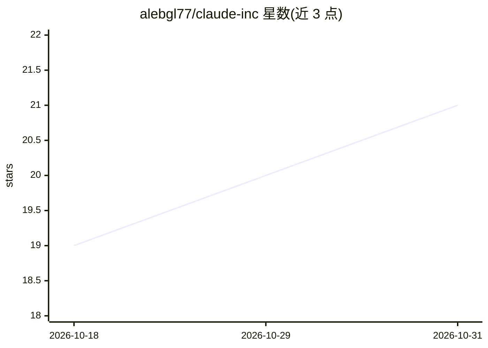

# alebgl77/claude-inc

⭐ 21 · Python · MIT · 推送 2026-10-22 · [GitHub](https://github.com/alebgl77/claude-inc) · [官网](https://alebgl77.github.io/claude-inc/) · 个人维护

**围绕用户项目组织虚拟公司的 Claude Code 结构化工作流**

以 Claude Code 为宿主的结构化项目工作流插件/CLI：把用户项目组织成一家虚拟公司，CEO/CTO/CAIO 三名同级高管将项目简报拆解为工作流，委派给 9 个部门（64 份技能手册即员工角色），生成本地任务契约与决策记录，提交文件记录 SHA-256 哈希并由不同部门评审，可跨会话恢复。提供 Claude Code 插件安装、curl/git clone 安装脚本（Windows 用 .NET 编译 company.exe），依赖 Bash 与 Python 3.9+。评审检查哈希与门槛但不运行测试、不判断工作质量。

## 筛选速览

| 维度 | 判定 | 备注 |
|---|---|---|
| AI 角色 | `ai-ecosystem` | LLM/agent 周边工具 |
| 许可风险 | `permissive` | MIT |
| 部署形态 | `desktop` | 安装包/桌面程序 |
| 模型依赖 | locked-api |  |
| 硬件要求 | — | 无带数字的原话,不猜 |
| 安装摩擦 | `low` | 无编译、无系统依赖或容器化 |
| 成熟度 | — | 结构信号不足 |

## 能力要点

- CEO/CTO/CAIO 同级高管与 9 部门、64 份技能手册的虚拟公司结构
- 任务契约 + SHA-256 文件哈希 + 不同部门评审的证据流程
- 跨会话从本地项目工作区恢复（company project start）
- 可选 review harness：light/balanced/deep 限制每任务 2/3/5 次提交

## 适用场景

- 让 AI 按部门分工推进产品或业务项目并留存决策记录
- 跨会话恢复项目状态继续未完成工作
- 对需要评审关卡的项目工作启用有界评审循环

## 场景标签

`多智能体` `工作流自动化` `编码 Agent` · 领域:Agent 开发

## 证据(README 行号)

> L24: The 64 employees are **skill manuals**, not 64 processes running in the
> L25: background. Claude Code supplies the active assistant session, native agent
> L44: **Claude Code plugin**: install in Claude Code, then open your project folder:

## 星数曲线

2026-10-18 19 → 2026-10-31 21（+2）

---
*卡片 v1 · prompt 1.4 · 生成 2026-10-28 · 置信度 high · 依据 README sha `10ddf357ad8c` · [字段定义](../../DATASET.md)*
