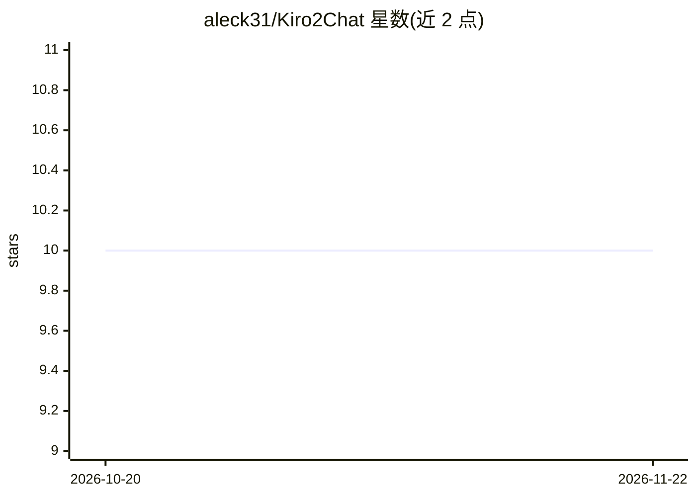

# aleck31/Kiro2Chat

⭐ 10 · Python · 推送 2026-06-23 · [GitHub](https://github.com/aleck31/Kiro2Chat) · 个人维护 · 中文 README

**把 kiro-cli 接入 Telegram/飞书/Discord/Web 的聊天桥接器**

通过 ACP 协议（stdio 上的 JSON-RPC 2.0）将 kiro-cli 桥接到四个聊天平台，各适配器支持流式输出、工具调用展示、图片输入输出与权限审批（TG 内联键盘/Web 卡片/文本兜底）。会话按 workspace 键控，实现跨平台共享同一 kiro 会话；NiceGUI 管理面板提供适配器启停、会话统计与配置；支持 cron/间隔心跳任务、多 workspace、按适配器白名单鉴权与一次性 claim token 入群。前置要求 kiro-cli 已安装并登录。

## 筛选速览

| 维度 | 判定 | 备注 |
|---|---|---|
| AI 角色 | `ai-ecosystem` | LLM/agent 周边工具 |
| 许可风险 | `none` | — |
| 部署形态 | `None` |  |
| 模型依赖 | — | README 未给出锁定关系 |
| 硬件要求 | — | 无带数字的原话,不猜 |
| 安装摩擦 | `low` | 无编译、无系统依赖或容器化 |
| 成熟度 | — | 结构信号不足 |

## 能力要点

- 通过 ACP 协议（JSON-RPC 2.0 over stdio）与 kiro-cli 通信
- 四平台适配器：Telegram/飞书/Discord/Web，均支持流式与图片 I/O
- 会话按 workspace 键控，跨平台共享同一 kiro 会话
- NiceGUI 管理面板与可选 Cognito OIDC SSO

## 适用场景

- 在 Telegram 或飞书群里直接调用 kiro-cli 处理任务
- 多平台成员协作共享同一 agent 工作区会话
- 用定时心跳任务定期运行 kiro 提示词并推送结果

## 场景标签

`聊天机器人` · 领域:对话与助手

## 证据(README 行号)

> L5: Bridge kiro-cli to chat platforms (Telegram, Lark/Feishu, Discord, Web) via ACP protocol.
> L9: - 🔗 **ACP Protocol** — Communicates with kiro-cli via JSON-RPC 2.0 over stdio
> L50: # Prerequisites: kiro-cli installed and logged in

## 星数曲线

2026-10-20 10 → 2026-11-22 10（+0）

---
*卡片 v1 · prompt 1.4 · 生成 2026-11-20 · 置信度 high · 依据 README sha `1fb59d9418ad` · [字段定义](../../DATASET.md)*
