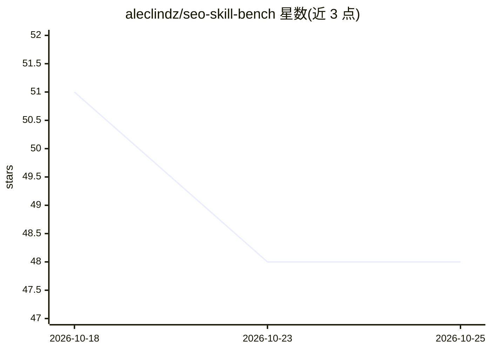

# aleclindz/seo-skill-bench

⭐ 48 · JavaScript · MIT · 推送 2026-10-19 · [GitHub](https://github.com/aleclindz/seo-skill-bench) · [官网](https://seoagent.com/seo-skill-benchmark) · 组织维护

**SEO 技能评测基准：在含预埋缺陷的固定站点上实测打分**

面向 Claude Code（及其他编码 agent）SEO 技能的开放基准：将被测技能安装进真实 headless agent 会话（claude -p），针对含预埋缺陷与陷阱的固定站点运行，以答案键确定性计分（缺陷检出 40%、陷阱规避 25%），残余主观部分由匿名盲评 LLM 评委打分；评分权重在 RUBRIC.md 中预注册并版本化。另测量每个技能的上下文占用（常驻 token 等）。维护方 SEOAgent 自身技能也是参赛者，README 列出结构性缓解措施。运行需 Node≥20 与 claude CLI。

## 筛选速览

| 维度 | 判定 | 备注 |
|---|---|---|
| AI 角色 | `ai-ecosystem` | LLM/agent 周边工具 |
| 许可风险 | `permissive` | MIT |
| 部署形态 | `None` |  |
| 模型依赖 | — | README 未给出锁定关系 |
| 硬件要求 | — | 无带数字的原话,不猜 |
| 安装摩擦 | `low` | 无编译、无系统依赖或容器化 |
| 成熟度 | — | 结构信号不足 |

## 能力要点

- 真实 headless 执行（claude -p）而非模拟，被测技能实际安装运行
- 答案键确定性计分 + 预注册版本化评分权重（RUBRIC.md）
- 上下文占用测量：resident/activation/bundle tokens 与 footprint 分级
- 任何人可通过 skills.json 注册参赛并复跑，附完整记录

## 适用场景

- 为 Claude Code 选型 SEO 技能时比较实测得分
- 技能作者验证自家技能相对 vanilla 基线的表现
- 研究技能描述对 agent 上下文的 token 占用

## 场景标签

`模型评测` · 领域:评测与运维

## 证据(README 行号)

> L5: An open benchmark for comparing **SEO skills for Claude Code** (and other coding agents).
> L33: **seo-skill-bench scores skills by running them for real against fixture sites with

## 星数曲线

2026-10-18 51 → 2026-10-25 48（-3）

---
*卡片 v1 · prompt 1.4 · 生成 2026-10-25 · 置信度 high · 依据 README sha `446dfc3088c4` · [字段定义](../../DATASET.md)*
