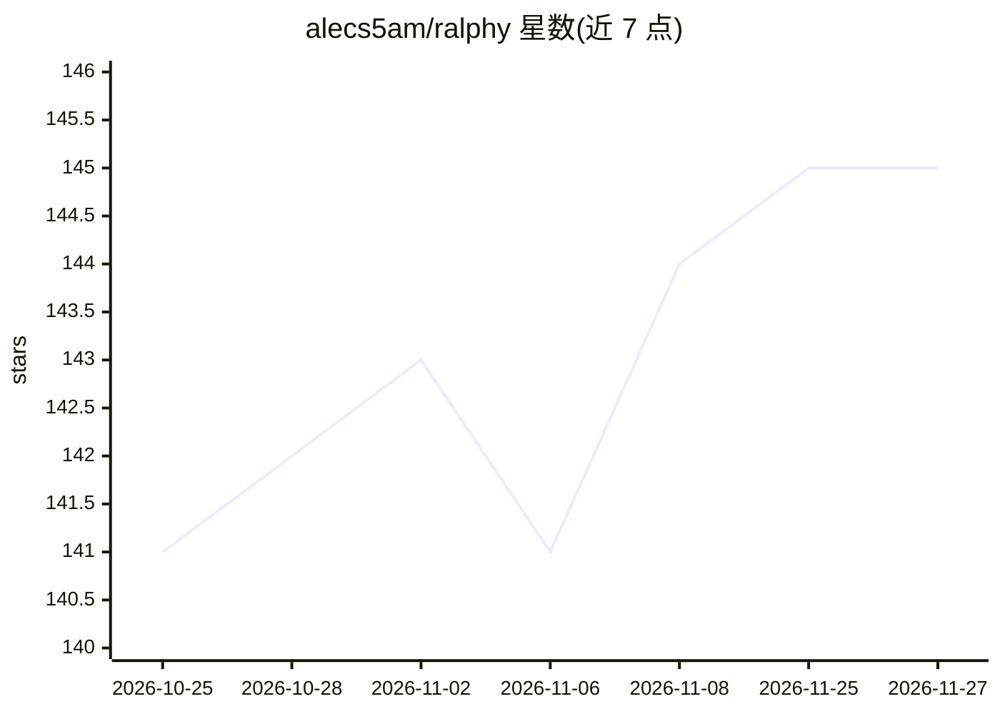

# alecs5am/ralphy

⭐ 145 · Python · Apache-2.0 · 推送 2026-11-18 · [GitHub](https://github.com/alecs5am/ralphy) · [官网](https://alecs5am.com/ralphy) · 个人维护

**给编码 Agent 加短视频制作与发布能力的插件**

Ralphy 以插件形式接入 Claude Code、Codex 或任何读取 skills 的 Agent，补充 Agent 自身不具备的能力：趋势视频库与细分领域选品、本地内容/账号管理面板、经用户逐条批准后向 YouTube/TikTok/Instagram/X 发布、可复用的动效组件与提示词库。工作流为复制参考视频的结构节奏，再改写为账号风格，生成前显示费用。通过 uv 自装 Python 环境，HyperFrames 渲染需 Bun，另需 ffmpeg 与 Chrome；密钥经 fal 等服务调用。

## 筛选速览

| 维度 | 判定 | 备注 |
|---|---|---|
| AI 角色 | `ai-native` | 本体是模型或模型工具 |
| 许可风险 | `permissive` | Apache-2.0 |
| 部署形态 | `None` |  |
| 模型依赖 | — | README 未给出锁定关系 |
| 硬件要求 | — | 无带数字的原话,不猜 |
| 安装摩擦 | `medium` | 含编译或系统依赖之一 |
| 成熟度 | — | 结构信号不足 |

## 能力要点

- 以插件/marketplace 形式接入 Claude Code 与 Codex，其他 Agent 可 git clone 接入
- 趋势库提供超越创作者常规数据的表现参考，逐条发布需用户批准
- 每个账号使用独立浏览器配置文件发布
- 无遥测，请求仅发往用户配置密钥的服务

## 适用场景

- 让编码 Agent 为我的 TikTok/YouTube Shorts 账号批量产出竖屏短视频
- 先看费用再决定是否进行付费视频生成
- 经我批准后由 Agent 定时发布到我的各平台账号

## 场景标签

`视频生成` · 领域:内容生成

## 证据(README 行号)

> L3: Ralphy is a plugin for your coding agent (Claude Code, Codex, or any agent that reads skills) that
> L7: 1. **Trendwatching.** A hosted trend base of videos that beat their creator's usual numbers, plus
> L16: beat, text, sound), then reworks the copy for your account (your style, subject, text and offer),

## 星数曲线

2026-10-25 141 → 2026-11-27 145（+4）

---
*卡片 v1 · prompt 1.4 · 生成 2026-11-27 · 置信度 high · 依据 README sha `1868926ff5c4` · [字段定义](../../DATASET.md)*
