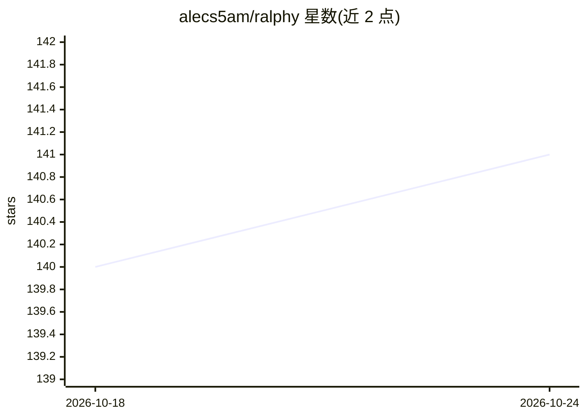

# alecs5am/ralphy

⭐ 141 · TypeScript · Apache-2.0 · 推送 2026-09-22 · [GitHub](https://github.com/alecs5am/ralphy) · [官网](https://alecs5am.com/ralphy) · 个人维护

**开源内容创作桌面应用与 agent 运行时，生成短视频等内容**

Apache 2.0 许可的桌面应用（apps/desktop）加独立 CLI 运行时（cli），把项目管理、媒体审阅、内容生成与本地 agent 汇在一处。用户在对话中下达指令（如“做一个春季浓缩咖啡广告”），agent 通过 ralphy <verb> 命令面驱动项目创建、模板推荐与脚手架；渲染采用 HyperFrames（HTML+GSAP，Puppeteer+FFmpeg 确定性渲染），模型经 OpenRouter 调用（Kling/Seedance/Veo/Sora 等），语音用 ElevenLabs。每次模型调用写入 generations.jsonl，--dry-run 显示预估费用，失败记录 postmortem。桌面开发需 Bun 1.4.2 与 macOS，运行时二进制提供 brew/curl/npm 等四渠道安装。

## 筛选速览

| 维度 | 判定 | 备注 |
|---|---|---|
| AI 角色 | `ai-native` | 本体是模型或模型工具 |
| 许可风险 | `permissive` | Apache-2.0 |
| 部署形态 | `library` | 以包/库形式分发 |
| 模型依赖 | locked-api |  |
| 硬件要求 | — | 无带数字的原话,不猜 |
| 安装摩擦 | `medium` | 含编译或系统依赖之一 |
| 成熟度 | — | 结构信号不足 |

## 能力要点

- 桌面应用与独立 CLI 共享同一运行时与桥接契约
- ralphy <verb> 单一入口：所有模型调用落 generations.jsonl，--dry-run 预估账单
- HyperFrames（HTML+GSAP）作曲器，版本化入 git 并在 CI 测试
- OpenRouter 接入多模型（Kling/Seedance/Veo/Sora 等），配 5 种 agent 角色路由

## 适用场景

- 我用对话指令让本地 agent 制作短视频/reels 内容
- 我在桌面应用里统一管理内容项目、媒体与生成工具
- 我需要可复现、可审计（生成日志+费用汇总）的 AI 内容流水线

## 场景标签

`视频生成` · 领域:内容生成

## 证据(README 行号)

> L5: **An open-source desktop app for creating and managing content.** Work with projects, media, generation tools, and l
> L80: In practice you say "make a spring espresso ad" in chat and the agent runs these verbs for you. Here's the surface 
> L117: |Models|Vendor lock-in|One model, hardcoded|**Any OpenRouter model — Kling / Seedance / Veo / Sora / Nano-Banana**

## 星数曲线

2026-10-18 140 → 2026-10-24 141（+1）

---
*卡片 v1 · prompt 1.4 · 生成 2026-10-22 · 置信度 high · 依据 README sha `34c2dbe0cbaf` · [字段定义](../../DATASET.md)*
