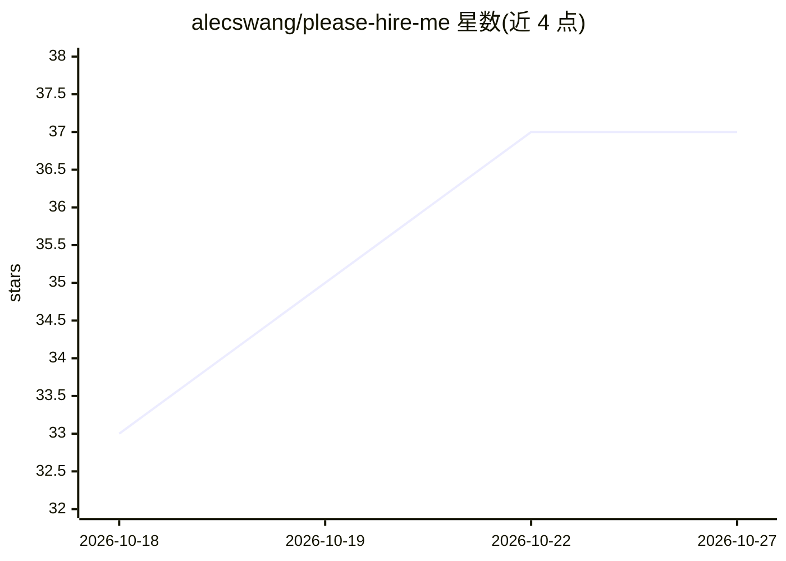

# alecswang/please-hire-me

⭐ 37 · Python · MIT · 推送 2026-10-23 · [GitHub](https://github.com/alecswang/please-hire-me) · 个人维护

**求职者的自动投递 agent：在真实 ATS 表单中代填并提交申请**

运行在 Claude Code（配合 Claude in Chrome 扩展）或 Grok Bot 之上的求职申请自动化 agent。首次设置通过一次约五分钟的对话读取简历、生成 profile/answers/settings 三个配置文件；此后自主查找在招岗位，逐字段填写 Greenhouse/Lever/Ashby 等公司自有表单并提交。每次提交前截图记录答案，声明不虚构简历外的事实；登录、2FA 与 CAPTCHA 交还人工处理。支持定时运行、按公司冻结、封面信与针对性简历（LaTeX 生成）生成，以及公司门户与 Gmail 验证码两个可选扩展。

## 筛选速览

| 维度 | 判定 | 备注 |
|---|---|---|
| AI 角色 | `ai-native` | 本体是模型或模型工具 |
| 许可风险 | `permissive` | MIT |
| 部署形态 | `None` |  |
| 模型依赖 | locked-api |  |
| 硬件要求 | — | 无带数字的原话,不猜 |
| 安装摩擦 | `low` | 无编译、无系统依赖或容器化 |
| 成熟度 | — | 结构信号不足 |

## 能力要点

- 自动查找岗位并逐字段填写 Greenhouse/Lever/Asheby 表单后提交
- 设置阶段从简历生成三个配置文件，逐项展示供用户核对
- 每次提交截图留档，声明不虚构事实；登录/2FA/CAPTCHA 交还人工
- 默认生成 150-250 词封面信与按岗位裁剪的 LaTeX 单页简历

## 适用场景

- 应届生或实习生批量投递多公司岗位并按质量门槛过滤
- 夜间定时运行，自主完成申请并留下提交记录
- 对每个岗位生成针对性的封面信与重排版简历

## 场景标签

`浏览器自动化` `AI 写作` · 领域:效率与自动化

## 证据(README 行号)

> L3: **An agent that fills out real job applications while you sleep.**
> L11: You set it up once, in one conversation of about five minutes, and it writes your config from your
> L13: alike, filling the company's own Greenhouse / Lever / Ashby form field by field in your real Chrome,

## 星数曲线

2026-10-18 33 → 2026-10-27 37（+4）

---
*卡片 v1 · prompt 1.4 · 生成 2026-10-25 · 置信度 high · 依据 README sha `b5eb0f1fcdc1` · [字段定义](../../DATASET.md)*
