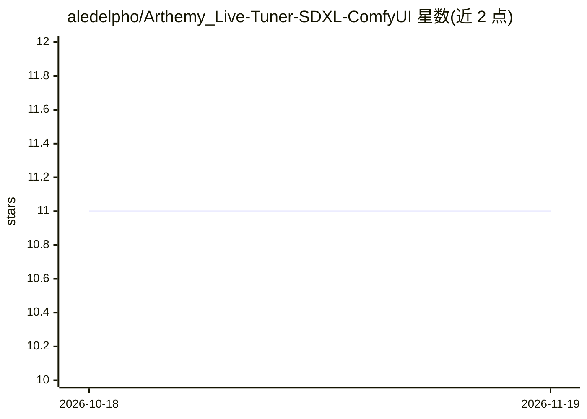

# aledelpho/Arthemy_Live-Tuner-SDXL-ComfyUI

⭐ 11 · Python · Apache-2.0 · 推送 2026-01-18 · [GitHub](https://github.com/aledelpho/Arthemy_Live-Tuner-SDXL-ComfyUI) · 个人维护

**免训练调节 SDXL/U-Net 与 CLIP 分区强度的 ComfyUI 节点**

一组 ComfyUI 自定义节点，借鉴模型合并工具的分块逻辑，将单个 SDXL 系模型（含 Illustrious、NAI 变体）的 U-Net 拆分为输入/中间/输出功能分区（如构图、风格、光照、细节），并以滑杆权重增减各分区强度；同时把 32 层 CLIP (ViT-bigG) 划分为语法/语义/风格三块。提供 Soft 与 Real Value 两种加权模式，无需训练，可直接嵌入既有工作流。安装方式为克隆到 ComfyUI custom_nodes 目录并重启。

## 筛选速览

| 维度 | 判定 | 备注 |
|---|---|---|
| AI 角色 | `ai-ecosystem` | LLM/agent 周边工具 |
| 许可风险 | `permissive` | Apache-2.0 |
| 部署形态 | `None` |  |
| 模型依赖 | — | README 未给出锁定关系 |
| 硬件要求 | — | 无带数字的原话,不猜 |
| 安装摩擦 | `low` | 无编译、无系统依赖或容器化 |
| 成熟度 | — | 结构信号不足 |

## 能力要点

- U-Net 按 Layout/Core/Style 等 11 个功能分区独立加权
- CLIP 32 层划分为 Syntax/Semantic/Style 三个语义区块
- Soft 与 Real Value 两种加权模式
- 无需训练，作用于单个模型而非模型合并

## 适用场景

- 生成后微调风格、光照、细节而不重新训练模型
- 在 ComfyUI 工作流中嵌入分区权重节点
- 调整提示词解析的语法刚性与风格抽象程度

## 场景标签

`图像生成` · 领域:内容生成

## 证据(README 行号)

> L1: # Arthemy Live Tuner SDXL • ComfyUI nodes
> L12: I utilized the block-splitting logic found in tools like "SDXL Block Merge" and reorganized those technical segment
> L14: This process is fast and can be seamlessly integrated into any workflow, effectively transforming static checkpoint

## 星数曲线

2026-10-18 11 → 2026-11-19 11（+0）

---
*卡片 v1 · prompt 1.4 · 生成 2026-11-18 · 置信度 high · 依据 README sha `6919696fd584` · [字段定义](../../DATASET.md)*
