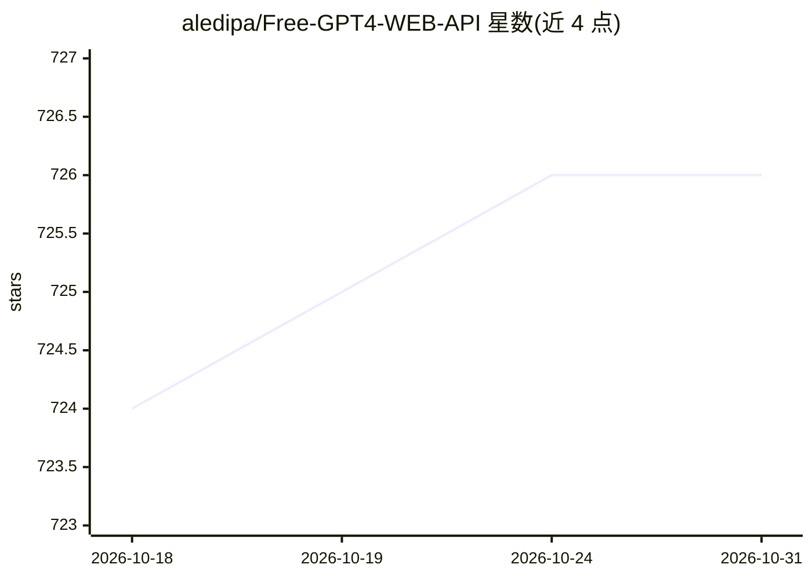

# aledipa/Free-GPT4-WEB-API

⭐ 726 · Python · GPL-3.0 · 推送 2026-08-14 · [GitHub](https://github.com/aledipa/Free-GPT4-WEB-API) · [官网](https://api.freegpt4.ddns.net/?text=Your Request Here) · 个人维护

**自托管 Web API：免 API key 统一调用 GPT-4 等多家 LLM**

基于 Flask 与 g4f 库的自托管 HTTP API 服务，通过 Web 逆向通道访问 GPT-4、GPT-4o、deepseek-r1 等模型，无需 API key，默认返回纯文本。支持 Docker 或 Python 源码运行，提供可选 Web GUI 配置模型/Provider/Cookie 等参数，默认监听 5500 端口。机制上带 Provider 自动回退（Bing/DuckDuckGo 等）、30 秒超时重试、健康监控与黑名单系统；部分 Provider 需 cookies 文件，Docker 下 GUI 强制设密码。还提供 Siri 快捷指令集成。GPL-3.0 许可。

## 筛选速览

| 维度 | 判定 | 备注 |
|---|---|---|
| AI 角色 | `ai-ecosystem` | LLM/agent 周边工具 |
| 许可风险 | `viral` | GPL-3.0 |
| 部署形态 | `self-host` | docker 或自建部署 |
| 模型依赖 | — | README 未给出锁定关系 |
| 硬件要求 | — | 无带数字的原话,不猜 |
| 安装摩擦 | `low` | 无编译、无系统依赖或容器化 |
| 成熟度 | — | 结构信号不足 |

## 能力要点

- 无 API key、无限请求的单端点纯文本 HTTP 接口
- Provider 自动回退与健康监控、30 秒超时重试、黑名单系统
- Docker 镜像与 Python 源码两种运行方式，Web GUI 可配置模型/Cookie/代理
- Siri 快捷指令调用自托管 API

## 适用场景

- 不想申请 API key 就给自己的脚本/应用接一个 LLM 接口
- 本地或服务器自托管一个统一的多 Provider 文本生成 API
- 通过 Siri 语音调用自己部署的 GPT 服务

## 场景标签

`模型网关` · 领域:Agent 开发

## 证据(README 行号)

> L7: Self-hosted web API that exposes free, unlimited access to modern LLM providers through a single, simple HTTP interf
> L223: - g4f (from https://github.com/xtekky/gpt4free)

## 星数曲线

2026-10-18 724 → 2026-10-31 726（+2）

---
*卡片 v1 · prompt 1.4 · 生成 2026-10-21 · 置信度 mid · 依据 README sha `23c4458999b4` · [字段定义](../../DATASET.md)*
