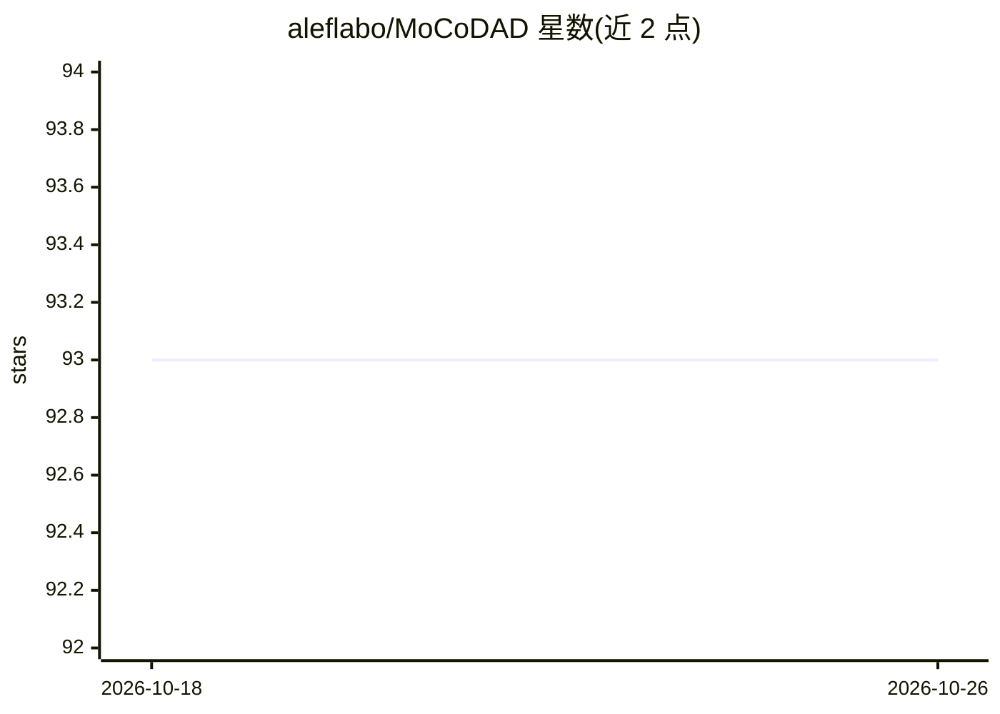

# aleflabo/MoCoDAD

⭐ 93 · Jupyter Notebook · MIT · 推送 2026-05-17 · [GitHub](https://github.com/aleflabo/MoCoDAD) · [官网](https://openaccess.thecvf.com/content/ICCV2023/html/Flaborea_Multimodal_Motion_Conditioned_Diffusion_Model_for_Skeleton-based_Video_Anomaly_Detection_ICCV_2023_paper.html) · 组织维护

**基于骨架与扩散模型的视频异常检测 PyTorch 官方实现**

ICCV '23 论文 Multimodal Motion Conditioned Diffusion Model for Skeleton-based Video Anomaly Detection 的官方 PyTorch 实现。模型读取骨架姿态序列，通过多模态运动条件扩散过程进行训练与推理，用于视频异常检测。支持 inject/concat/random_imp 等多种条件注入策略，可配置扩散步数；提供 HR-Avenue、HR-ShanghaiTech、HR-UBnormal 三个数据集的提取姿态下载与预训练检查点，并附带自定义数据集的姿态提取与目标跟踪代码及可视化脚本。训练与评估通过 config YAML 驱动，实验跟踪使用 wandb。

## 筛选速览

| 维度 | 判定 | 备注 |
|---|---|---|
| AI 角色 | `ai-native` | 本体是模型或模型工具 |
| 许可风险 | `permissive` | MIT |
| 部署形态 | `None` |  |
| 模型依赖 | — | README 未给出锁定关系 |
| 硬件要求 | — | 无带数字的原话,不猜 |
| 安装摩擦 | `low` | 无编译、无系统依赖或容器化 |
| 成熟度 | — | 结构信号不足 |

## 能力要点

- 运动条件扩散模型用于骨架级视频异常检测
- 5 种条件注入策略与可配置扩散步数
- 提供三个数据集的预训练检查点与提取姿态数据
- 附带自定义数据集姿态提取、actor 跟踪与异常分数可视化代码

## 适用场景

- 在 Avenue/UBnormal/STC 数据集上复现论文的异常检测实验
- 用预训练模型直接评估骨架视频异常检测
- 将自有视频数据集适配为骨架输入进行训练

## 场景标签

 · 领域:计算机视觉/视频异常检测

## 证据(README 行号)

> L1: # Multimodal Motion Conditioned Diffusion Model for Skeleton-based Video Anomaly Detection
> L7: The official PyTorch implementation of the IEEE/CVF International Conference on Computer Vision (ICCV) '23 paper **M

## 星数曲线

2026-10-18 93 → 2026-10-26 93（+0）

---
*卡片 v1 · prompt 1.4 · 生成 2026-10-23 · 置信度 high · 依据 README sha `9800c7c90099` · [字段定义](../../DATASET.md)*
