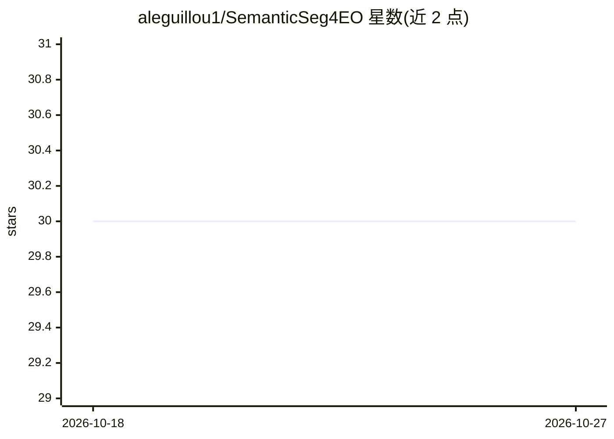

# aleguillou1/SemanticSeg4EO

⭐ 30 · Python · GPL-2.0 · 推送 2026-05-08 · [GitHub](https://github.com/aleguillou1/SemanticSeg4EO) · 个人维护

**卫星影像语义分割的 PyTorch 统一训练推理框架**

面向遥感/对地观测领域的语义分割框架，覆盖从数据准备到推理的端到端流程：用矢量网格将大图切分为训练补丁，支持 15+ 架构（SegFormer、ConvNeXt、HRNet、Swin-UNet 及 SMP 系列模型）、K 折交叉验证（含 95% 置信区间）、四级数据增强与 10+ 损失函数。推理采用滑动窗口加高斯融合处理任意大小 GeoTIFF，并保留 CRS 与地理参考元数据。支持 1-20+ 波段多光谱影像与二分类/多分类任务，通过 git clone 加 pip 安装依赖使用。

## 筛选速览

| 维度 | 判定 | 备注 |
|---|---|---|
| AI 角色 | `ai-native` | 本体是模型或模型工具 |
| 许可风险 | `viral` | GPL-2.0 |
| 部署形态 | `library` | 以包/库形式分发 |
| 模型依赖 | — | README 未给出锁定关系 |
| 硬件要求 | — | 无带数字的原话,不猜 |
| 安装摩擦 | `medium` | 含编译或系统依赖之一 |
| 成熟度 | — | 结构信号不足 |

## 能力要点

- 15+ 分割架构：SegFormer、ConvNeXt、UNetFormer、HRNet、Swin-UNet 及 SMP 系列
- 滑动窗口 + 高斯加权融合推理，支持任意大小 GeoTIFF 并保留地理参考
- K 折交叉验证，输出均值、标准差与 95% 置信区间
- 1-20+ 波段多光谱影像支持与类别不平衡处理（focal loss、少数类过采样）

## 适用场景

- 对多光谱卫星或航拍影像做二分类/多分类地物分割
- 在小数据集上用 K 折交叉验证做可靠的模型评估
- 对大幅卫星场景做无缝大规模推理并保留地理参考

## 场景标签

`目标检测` · 领域:感知与多模态

## 证据(README 行号)

> L3: **A Comprehensive Framework for Semantic Segmentation of Earth Observation Imagery**
> L9: SemanticSeg4EO is a state-of-the-art framework for semantic segmentation of satellite and aerial imagery, supporting
> L28: SemanticSeg4EO provides a complete pipeline for Earth Observation (EO) data segmentation:

## 星数曲线

2026-10-18 30 → 2026-10-27 30（+0）

---
*卡片 v1 · prompt 1.4 · 生成 2026-10-26 · 置信度 mid · 依据 README sha `5e6429a05e79` · [字段定义](../../DATASET.md)*
