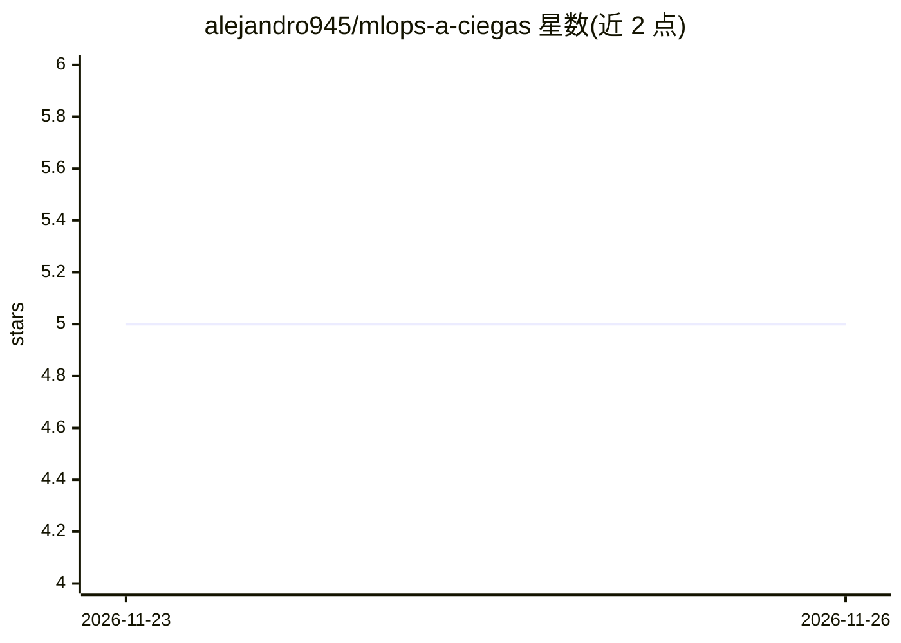

# alejandro945/mlops-a-ciegas

⭐ 5 · HTML · 推送 2026-11-19 · [GitHub](https://github.com/alejandro945/mlops-a-ciegas) · 个人维护

**演示项目：把泵声异常检测模型从云端部署到边缘 IoT 设备并保持治理**

作者在 DevOpsDays Bogotá 2026 演讲的配套代码库，案例为虚构的乡村泵站：模型监听水泵声音，声音异常时触发告警，音频不出站，只上传数百字节的事件。包含完整 demo（模型、IoT Greengrass 组件、Docker 模拟的五个泵、Terraform 云端基础设施）、西语演讲材料与幻灯片，GitHub Actions 含测试与 OIDC 方式的 Terraform plan/apply。音频数据来自 MIMII DUE 数据集（CC BY-NC-SA 4.0），需另行从 Zenodo 下载；部署到 AWS 会产生 EC2 计费。

## 筛选速览

| 维度 | 判定 | 备注 |
|---|---|---|
| AI 角色 | `ai-native` | 本体是模型或模型工具 |
| 许可风险 | `none` | — |
| 部署形态 | `library` | 以包/库形式分发 |
| 模型依赖 | — | README 未给出锁定关系 |
| 硬件要求 | — | 无带数字的原话,不猜 |
| 安装摩擦 | `low` | 无编译、无系统依赖或容器化 |
| 成熟度 | — | 结构信号不足 |

## 能力要点

- 端到端 demo：模型 + IoT Greengrass 组件 + Docker 模拟泵 + Terraform
- 边缘侧推理设计：音频不出站，仅上传数百字节事件
- GitHub Actions：PR 测试与 OIDC 无密钥的 Terraform plan/apply
- 附带西语演讲幻灯片与讲稿（可离线打开）

## 适用场景

- 学习如何将云端模型部署到 Greengrass 边缘设备
- 复现带治理流程的边缘 MLOps 演示
- 参考 Terraform + OIDC 的无密钥基础设施部署方式

## 场景标签

`MLOps` · 领域:训练与推理

## 证据(README 行号)

> L5: How to take a model from the cloud to devices you cannot see, and keep it governed. The case is a rural pumping stat
> L11: |`poc-devopsdays/`|The full demo: the model, the IoT Greengrass component, five simulated pumps in Docker, the demo

## 星数曲线

2026-11-23 5 → 2026-11-26 5（+0）

---
*卡片 v1 · prompt 1.4 · 生成 2026-11-23 · 置信度 high · 依据 README sha `866c973ff606` · [字段定义](../../DATASET.md)*
