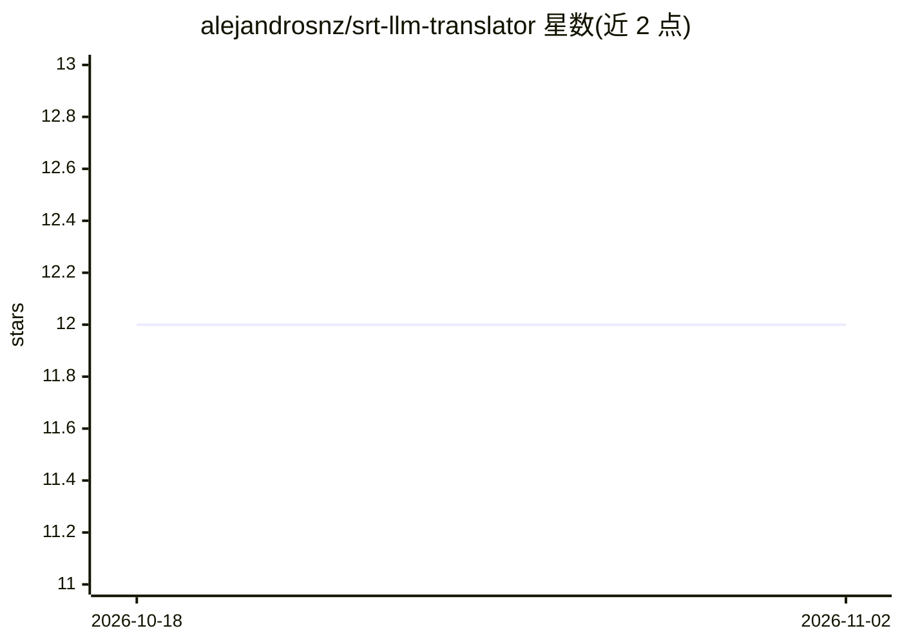

# alejandrosnz/srt-llm-translator

⭐ 12 · Python · GPL-3.0 · 推送 2026-04-07 · [GitHub](https://github.com/alejandrosnz/srt-llm-translator) · 个人维护

**用 LLM 翻译 SRT 字幕文件的 Python 脚本与 n8n 工作流**

提供两种使用方式的字幕翻译工具：Python 命令行脚本本地运行，或导入 n8n 实例的可视化工作流。读取 SRT 文件后调用 OpenAI 兼容 API 完成翻译，保留原时间轴便于回嵌视频；支持按文件夹批量处理、可配置批大小（默认每请求 50 行）与并发线程数（默认 5）。通过覆盖环境变量可切换 OpenRouter、Google Gemini、xAI Grok 等提供商。限制：n8n 版本目前不支持多文件。

## 筛选速览

| 维度 | 判定 | 备注 |
|---|---|---|
| AI 角色 | `ai-native` | 本体是模型或模型工具 |
| 许可风险 | `viral` | GPL-3.0 |
| 部署形态 | `library` | 以包/库形式分发 |
| 模型依赖 | locked-api |  |
| 硬件要求 | — | 无带数字的原话,不猜 |
| 安装摩擦 | `low` | 无编译、无系统依赖或容器化 |
| 成熟度 | — | 结构信号不足 |

## 能力要点

- 翻译 SRT 字幕并保留原始时间轴
- 支持 OpenAI、Gemini、Grok、OpenRouter 多个 LLM 提供商
- 批量大小与并发线程数可配置（默认 50 行/请求、5 线程）
- 同时提供 Python 脚本与 n8n 可视化工作流两种形式

## 适用场景

- 把外语视频字幕翻译成目标语言后回嵌视频
- 批量翻译目录下的多个 SRT 字幕文件
- 在 n8n 自动化流水线中集成字幕翻译步骤

## 场景标签

 · 领域:字幕翻译/LLM 应用

## 证据(README 行号)

> L4: The SRT LLM Translator translates subtitles from one language to another using large language models. It preserves t
> L13: - Utilizes OpenAI's API for translation.

## 星数曲线

2026-10-18 12 → 2026-11-02 12（+0）

---
*卡片 v1 · prompt 1.4 · 生成 2026-11-01 · 置信度 mid · 依据 README sha `ecb451d3c6ef` · [字段定义](../../DATASET.md)*
