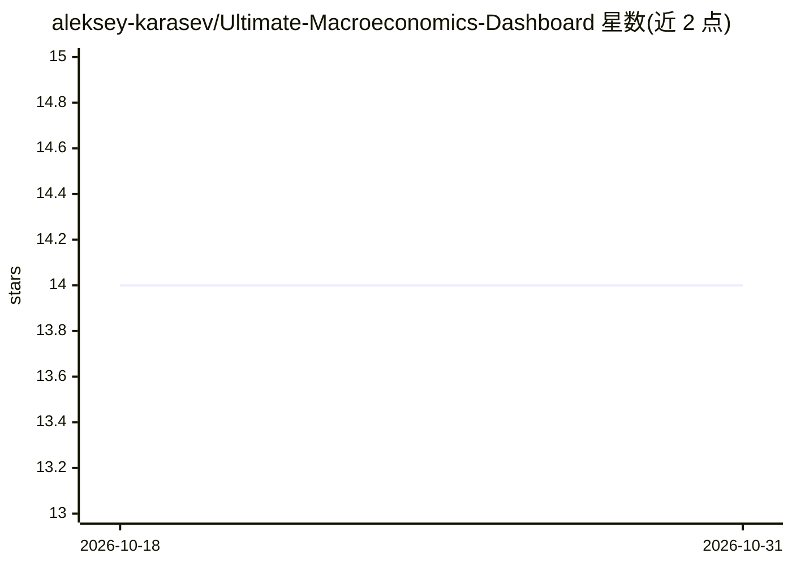

# aleksey-karasev/Ultimate-Macroeconomics-Dashboard

⭐ 14 · Python · MIT · 推送 2026-07-25 · [GitHub](https://github.com/aleksey-karasev/Ultimate-Macroeconomics-Dashboard) · 个人维护

**面向用户的宏观经济 AI 分析仪表盘（多页 Streamlit）**

基于 Docker 微服务架构的多页 Streamlit 宏观经济分析仪表盘：聚合世界银行、Yahoo Finance、Binance、FRED、Eurostat 数据及 3 万+ 篇新闻的 RAG 语料，提供多智能体 AI 分析师（LangGraph 监督者+专门工人，支持文本/图像/音频/文档多模态输入）、时间序列预测（ARIMA/Prophet/Chronos/XGBoost 等，经 Triton 推理）、聚类与按需数据摄取。含自托管 Langfuse 追踪与 Grafana/Prometheus 监控。运行需 NVIDIA GPU、Docker Compose、OpenAI 兼容 LLM 端点（≥256k 上下文）及多项 API key；首次数据下载约 1-2 小时。

## 筛选速览

| 维度 | 判定 | 备注 |
|---|---|---|
| AI 角色 | `ai-native` | 本体是模型或模型工具 |
| 许可风险 | `permissive` | MIT |
| 部署形态 | `self-host` | docker 或自建部署 |
| 模型依赖 | local-ok | 支持本地模型 |
| 硬件要求 | — | 无带数字的原话,不猜 |
| 安装摩擦 | `low` | 无编译、无系统依赖或容器化 |
| 成熟度 | — | 结构信号不足 |

## 能力要点

- 多智能体 AI 分析师（LangGraph supervisor + workers），支持文本/图像/音频/文档多模态输入
- 覆盖世界银行/Yahoo/Binance/FRED/Eurostat 数据源与 3 万+ 篇新闻 RAG 语料，150+ 预建图表
- 预测与聚类模型统一由 NVIDIA Triton Inference Server 托管
- 自托管 Langfuse LLM 追踪 + Grafana/Prometheus/OpenTelemetry 外部监控

## 适用场景

- 在交互式仪表盘中分析全球宏观经济指标与市场数据
- 对经济指标做时间序列预测与无监督聚类
- 通过多模态 AI 对话对经济数据提问并按需摄取新数据

## 场景标签

`数据分析` `多智能体` `RAG` `多模态` · 领域:Agent 开发

## 证据(README 行号)

> L23: `Ultimate Macroeconomics Dashboard` is an AI-powered macroeconomic analytics tool: a **multi-page Streamlit dashboa
> L42: * `app` — the multi-page Streamlit dashboard (this is what the user opens in the browser). It talks **directly** to
> L43: * `agent` — `FastAPI` backend hosting the multi-agent AI analyst (LangGraph supervisor + specialised workers).

## 星数曲线

2026-10-18 14 → 2026-10-31 14（+0）

---
*卡片 v1 · prompt 1.4 · 生成 2026-10-31 · 置信度 high · 依据 README sha `0c7714a6a572` · [字段定义](../../DATASET.md)*
