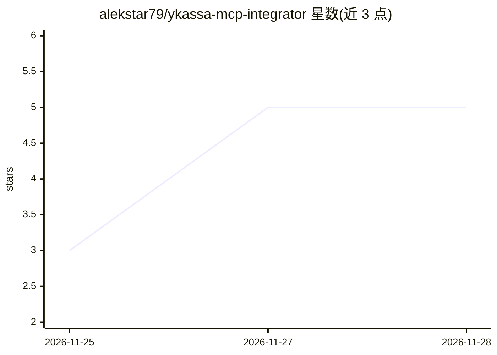

# alekstar79/ykassa-mcp-integrator

⭐ 5 · TypeScript · MIT · 推送 2026-11-26 · [GitHub](https://github.com/alekstar79/ykassa-mcp-integrator) · 个人维护

**将自然语言请求转为 YooKassa 支付操作的 AI agent 服务**

基于 TypeScript/Node.js 的支付代理服务：接收管理员的自然语言请求，通过 LLM 匹配并调用官方 YooKassa MCP 工具（创建/查询支付、账单、退款查询共 7 种），执行前按金额阈值与配置做校验。提供 headless HTTP API（Express 5）、Vue 3 参考界面、网页配置器与 npx CLI，支持 Telegram/MAX 消息网关。风险操作需人工确认，MCP 调用写入 JSONL 审计日志。参考实现不含认证与 RBAC，待确认状态存内存，重启丢失。

## 筛选速览

| 维度 | 判定 | 备注 |
|---|---|---|
| AI 角色 | `ai-native` | 本体是模型或模型工具 |
| 许可风险 | `permissive` | MIT |
| 部署形态 | `library` | 以包/库形式分发 |
| 模型依赖 | local-ok | 支持本地模型 |
| 硬件要求 | — | 无带数字的原话,不猜 |
| 安装摩擦 | `low` | 无编译、无系统依赖或容器化 |
| 成熟度 | — | 结构信号不足 |

## 能力要点

- 通过官方 YooKassa MCP 接入支付工具，运行时经 tools/list 校验可用性
- 风险操作 human-in-the-loop 确认（UI 卡片或 Telegram/MAX）
- 多客户端配置：品牌、allowlist、场景白名单与金额阈值
- MCP 调用写入 logs/mcp-calls.jsonl 审计日志

## 适用场景

- 让管理员用自然语言创建和查询 YooKassa 支付与账单
- 在 Telegram/MAX 中通过机器人处理支付请求并人工确认
- 基于 headless API 为自己的客户端构建支付操作界面

## 场景标签

`AI 助手` · 领域:对话与助手

## 证据(README 行号)

> L14: Сервис принимает запросы на естественном языке, выбирает доступный инструмент
> L110: - `apps/api` - headless API: MCP-клиент, LLM-оркестрация, подтверждения и аудит.
> L126: Удаление `apps/web` не влияет на API. Интеграция с YooKassa выполняется через

## 星数曲线

2026-11-25 3 → 2026-11-28 5（+2）

---
*卡片 v1 · prompt 1.4 · 生成 2026-11-24 · 置信度 high · 依据 README sha `82c4005098f3` · [字段定义](../../DATASET.md)*
