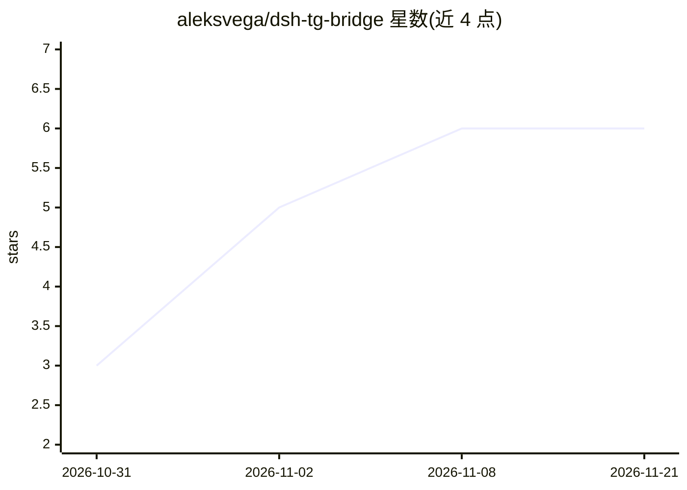

# aleksvega/dsh-tg-bridge

⭐ 6 · JavaScript · MIT · 推送 2026-11-16 · [GitHub](https://github.com/aleksvega/dsh-tg-bridge) · 个人维护 · 中文 README

**Telegram 远程驱动 DeepSeek Harness 的桥接机器人插件**

运行在已安装 DeepSeek Harness 的机器上，通过 Telegram bot 远程使用该 CLI：每个 forum topic 绑定独立项目（会话、工作目录、模型、权限），支持 /model 按路由切换模型、/diff 按 hunk 审查或回滚代码、/endpoint 从聊天中添加 provider、语音与图片输入、/cost 令牌与费用统计、配额耗尽时按 fallbackModels 链自动切换路由、消息日志重放防丢失。提供 ru/en/zhi 三语菜单，可作为 DSH 插件随主程序启动。

## 筛选速览

| 维度 | 判定 | 备注 |
|---|---|---|
| AI 角色 | `ai-ecosystem` | LLM/agent 周边工具 |
| 许可风险 | `permissive` | MIT |
| 部署形态 | `library` | 以包/库形式分发 |
| 模型依赖 | — | README 未给出锁定关系 |
| 硬件要求 | — | 无带数字的原话,不猜 |
| 安装摩擦 | `medium` | 含编译或系统依赖之一 |
| 成熟度 | — | 结构信号不足 |

## 能力要点

- topic 即项目：独立会话、目录、模型与权限沙箱
- 从聊天中添加 provider endpoint，密钥仅以环境变量名传递
- 配额/限流/5xx 等触发 fallbackModels 有序切换链
- 语音输入支持任意命令行引擎或 OpenAI 兼容 API

## 适用场景

- 不打开桌面应用，在 Telegram 里远程指挥代码代理
- 多个项目以不同 topic 分会话管理并各用各的模型
- 审查代理每轮的代码改动并按 hunk 解释或回退

## 场景标签

`编码 Agent` · 领域:编码与开发

## 证据(README 行号)

> L3: Drive DeepSeek Harness from Telegram. It runs on the
> L89: - DeepSeek Harness `0.2.1-rc.2` or newer in the `0.2.x` line (`>=0.2.1-rc.2 <0.3.0`)
> L140: The bridge is a client of the DSH CLI, and the surface it uses is small enough to

## 星数曲线

2026-10-31 3 → 2026-11-21 6（+3）

---
*卡片 v1 · prompt 1.4 · 生成 2026-11-20 · 置信度 high · 依据 README sha `5b22eb0dfa45` · [字段定义](../../DATASET.md)*
