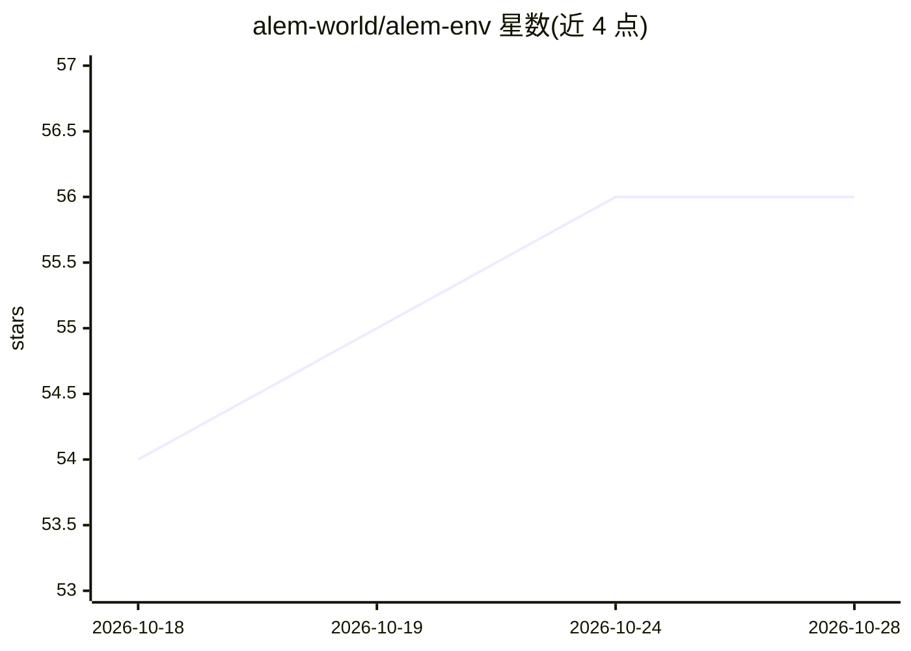

# alem-world/alem-env

⭐ 56 · Python · MIT · 推送 2026-09-10 · [GitHub](https://github.com/alem-world/alem-env) · [官网](https://alem-world.github.io) · 组织维护

**评测 LLM/MARL 智能体长期协调能力的 JAX 基准环境**

基于 Craftax 构建的 JAX 多智能体协调基准：程序化生成长程生存世界（探索、合成、交易、战斗），包含 93 个成就、27 个协调目标、可调协调难度，同一世界暴露符号、像素、文本三种接口，供 MARL 智能体、语言智能体与人类使用。附 LLM 评测 harness（源自 BALROG），支持 OpenAI/Anthropic/Gemini 等及 vLLM 本地服务，含 IPPO/MAPPO 等 RL 训练基线与三个 Docker 镜像，并有公开排行榜。Python 3.12、纯 JAX 实现。

## 筛选速览

| 维度 | 判定 | 备注 |
|---|---|---|
| AI 角色 | `ai-ecosystem` | LLM/agent 周边工具 |
| 许可风险 | `permissive` | MIT |
| 部署形态 | `self-host` | docker 或自建部署 |
| 模型依赖 | local-ok | 支持本地模型 |
| 硬件要求 | — | 无带数字的原话,不猜 |
| 安装摩擦 | `low` | 无编译、无系统依赖或容器化 |
| 成熟度 | — | 结构信号不足 |

## 能力要点

- 符号/像素/文本三接口，同一世界供 MARL、LLM 智能体和人类使用
- 程序化生成协调任务，协调难度可调（none–hard 或数值 alpha）
- LLM 评测 harness 支持任意 OpenAI 兼容服务并可提交排行榜
- CleanRL 风格 RL 训练基线（IPPO/MAPPO/PQN-VDN/HyperMARL）与单命令 Docker 评测

## 适用场景

- 评测 LLM 智能体团队在长程任务中的协调与通信能力
- 训练与对比 MARL 算法（IPPO/MAPPO 等）
- 人类玩家通过 pygame 界面体验基准任务
- 向公开排行榜提交模型协调得分

## 场景标签

`多智能体` `模型评测` `强化学习` · 领域:Agent 开发

## 证据(README 行号)

> L17: *Alem* is a JAX benchmark for open-ended multi-agent coordination. Building on Craftax and Multi-Agent Craftax / Cr
> L134: Alem is an **open leaderboard for multi-agent coordination**: evaluate any OpenAI-compatible model and submit your

## 星数曲线

2026-10-18 54 → 2026-10-28 56（+2）

---
*卡片 v1 · prompt 1.4 · 生成 2026-10-24 · 置信度 high · 依据 README sha `8db2cba1d9ae` · [字段定义](../../DATASET.md)*
