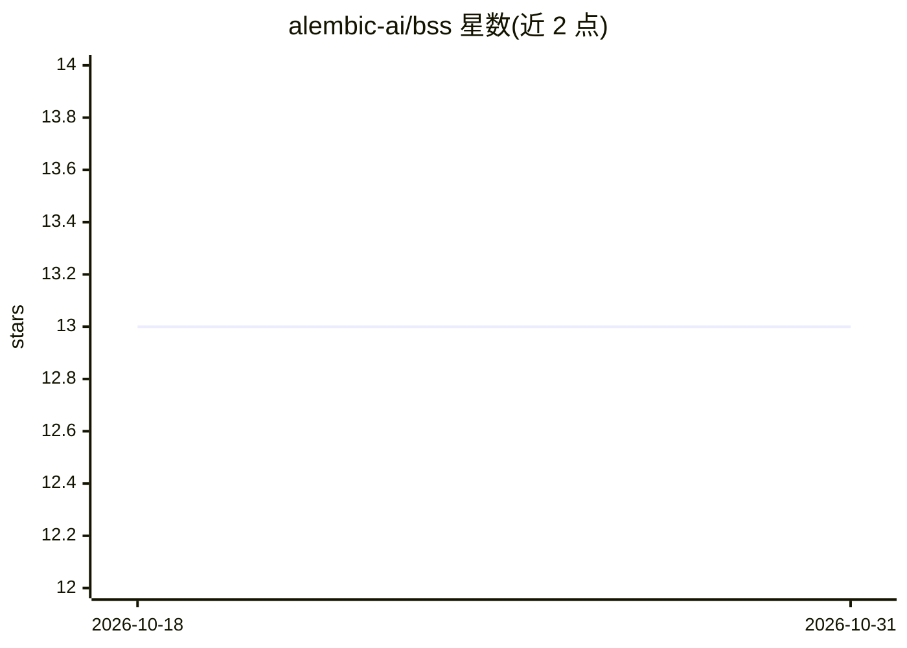

# alembic-ai/bss

⭐ 13 · Python · NOASSERTION · 推送 2026-03-15 · [GitHub](https://github.com/alembic-ai/bss) · [官网](https://alembicaistudios.com) · 组织维护

**基于文件的 AI 模型协调协议：用 Markdown 文件在模型间传递上下文**

面向多模型工作流的无状态 AI 模型协调协议：每次'blink'是一个 Markdown 文件，17 字符文件名编码作者、动作状态、置信度、范围等元数据，文件正文承载自然语言摘要与 lineage 图。无数据库、无 API、无共享内存，仅依赖磁盘文件，通过 /relay/、/active/、/profile/、/archive/ 四个目录组织会话接力。提供 TUI 配置网关、Web 监控面板与支持 6 种后端（本地 GGUF、Ollama、OpenAI 兼容、Anthropic、Gemini、Hugging Face）的 relay 终端。需要 Python 3.11+，源码安装。

## 筛选速览

| 维度 | 判定 | 备注 |
|---|---|---|
| AI 角色 | `ai-ecosystem` | LLM/agent 周边工具 |
| 许可风险 | `none` | NOASSERTION |
| 部署形态 | `desktop` | 安装包/桌面程序 |
| 模型依赖 | local-ok | 支持本地模型 |
| 硬件要求 | — | 无带数字的原话,不猜 |
| 安装摩擦 | `low` | 无编译、无系统依赖或容器化 |
| 成熟度 | — | 结构信号不足 |

## 能力要点

- 17 字符文件名编码结构化元数据（作者/状态/置信度/范围）
- 无数据库、无 API，仅靠文件系统协调多个 AI 模型
- relay 终端支持 6 种后端：GGUF、Ollama、OpenAI 兼容、Anthropic、Gemini、Hugging Face
- 提供终端配置网关与 Web 监控面板（时间线/lineage 可视化/任务看板）

## 适用场景

- 多个 AI 助手之间接力传递任务上下文，避免复制粘贴
- 跨会话的 bug 调查与知识沉淀，用不同模型继续未完成工作
- 本地模型与云端 API 共用同一协调层的本地优先工作流
- 小团队用 blink 归档构建可搜索的决策历史

## 场景标签

`多智能体` · 领域:Agent 开发

## 证据(README 行号)

> L3: A file-based coordination protocol for stateless AI models. Each "blink" is a Markdown file whose 17-character filen
> L166: 2. **Backend Configuration** — Select and configure your AI model provider (GGUF, Ollama, OpenAI, Anthropic, Gemin
> L251: The relay terminal is a TUI that lets models take turns reading the relay, running inference, and writing handoff 

## 星数曲线

2026-10-18 13 → 2026-10-31 13（+0）

---
*卡片 v1 · prompt 1.4 · 生成 2026-10-31 · 置信度 high · 依据 README sha `47450e6547a7` · [字段定义](../../DATASET.md)*
