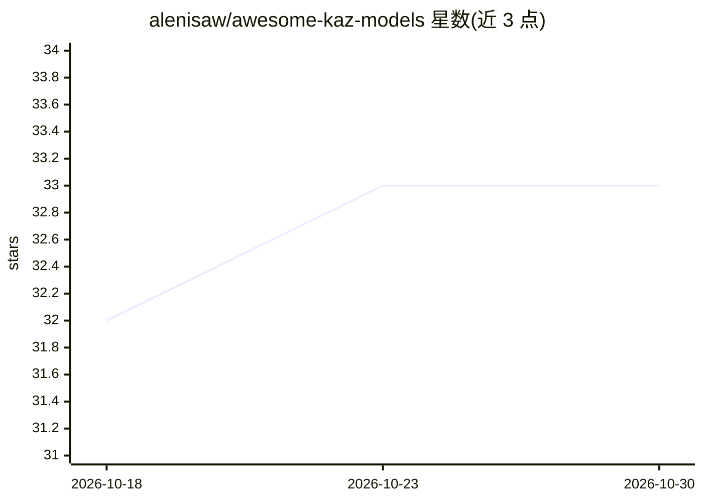

# alenisaw/awesome-kaz-models

⭐ 33 · Python · MIT · 推送 2026-10-04 · [GitHub](https://github.com/alenisaw/awesome-kaz-models) · 个人维护

**哈萨克语 AI 模型策展清单：收录已验证的公开模型**

面向研究者的 awesome 类清单：收录对哈萨克语有实质支持的公开 AI 模型，按 Text/NLP、Speech、Vision/OCR 三大类组织表格。每个条目记录发布日期、许可、访问方式、参数量、存储体积及基座模型，并逐条对照原始来源核验；仅宣布或无法独立核验的资源放入 Watchlist 而非主表。收录范围覆盖 LLM、嵌入、翻译、NER、问答、情感分类等任务，另提供按类别的累计发布趋势图与收录政策说明。

## 筛选速览

| 维度 | 判定 | 备注 |
|---|---|---|
| AI 角色 | `ai-knowledge` | 知识聚合/清单类 |
| 许可风险 | `permissive` | MIT |
| 部署形态 | `None` |  |
| 模型依赖 | — | README 未给出锁定关系 |
| 硬件要求 | — | 无带数字的原话,不猜 |
| 安装摩擦 | `low` | 无编译、无系统依赖或容器化 |
| 成熟度 | — | 结构信号不足 |

## 能力要点

- 按 Text/NLP、Speech、Vision/OCR 分类组织模型条目
- 逐条记录发布日期、许可、访问方式与哈萨克语训练证据
- 未核验资源单独放入 Watchlist，主表仅收录已验证条目
- 提供累计发布趋势图与 CONTRIBUTING 收录政策

## 适用场景

- 查找可获取的哈萨克语 LLM、嵌入或翻译模型
- 核查某模型的许可、访问门槛与哈萨克语训练依据
- 了解哈萨克语模型生态的发布历史与覆盖范围

## 场景标签

`精选清单` · 领域:学习与行业

## 证据(README 行号)

> L5:  A curated, research-grade catalog of public AI models with substantial support for the Kazakh language.
> L30: Every entry below is checked against its primary source, with release date,
> L43: |ID|Released|Model|Task|Description|Storage|Parameters|

## 星数曲线

2026-10-18 32 → 2026-10-30 33（+1）

---
*卡片 v1 · prompt 1.4 · 生成 2026-10-25 · 置信度 high · 依据 README sha `7bd873415738` · [字段定义](../../DATASET.md)*
