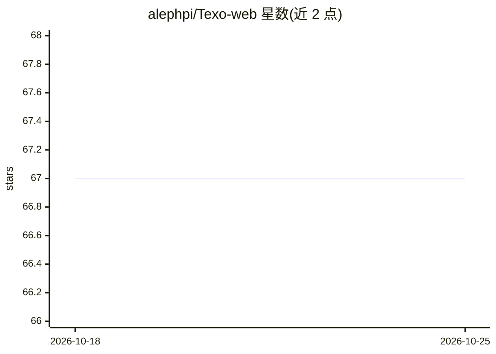

# alephpi/Texo-web

⭐ 67 · Vue · AGPL-3.0 · 推送 2026-09-18 · [GitHub](https://github.com/alephpi/Texo-web) · [官网](https://texocr.netlify.app) · 个人维护 · 中文 README

**在浏览器中运行 20M 参数 LaTeX OCR 模型的 Web 应用**

Texo-web 是 Texo LaTeX 公式识别模型的前端 Web 应用，基于 Nuxt 与 Transformers.js 构建，模型在浏览器端通过 web worker 运行，无需服务端推理。支持模型加载进度条、PWA、Typst 与 MathML 转换、WYSIWYG 编辑器与 KaTeX/MathLive 预览，并为中国大陆用户切换了模型远程源。Windows 用户可使用社区贡献的 Tauri 安装版。开发需 pnpm，提醒避免使用 snap 版 Node.js。AGPL-3.0 许可。

## 筛选速览

| 维度 | 判定 | 备注 |
|---|---|---|
| AI 角色 | `ai-native` | 本体是模型或模型工具 |
| 许可风险 | `viral` | AGPL-3.0 |
| 部署形态 | `library` | 以包/库形式分发 |
| 模型依赖 | — | README 未给出锁定关系 |
| 硬件要求 | — | 无带数字的原话,不猜 |
| 安装摩擦 | `low` | 无编译、无系统依赖或容器化 |
| 成熟度 | — | 结构信号不足 |

## 能力要点

- 20M 参数 LaTeX OCR 模型完全在浏览器端运行
- 支持 Typst / MathML 转换与 WYSIWYG 编辑器
- PWA 支持与中国大陆模型源切换
- 社区提供的 Windows Tauri 安装版

## 适用场景

- 在浏览器中把公式图片识别为 LaTeX 代码
- 将识别结果转为 Typst 或 MathML 格式使用
- 离线（PWA）或本地部署进行公式识别

## 场景标签

`OCR` · 领域:感知与多模态

## 证据(README 行号)

> L1: # Texo-web
> L2: The web application for Texo. Built with Nuxt.
> L25: - Texo: pretrained LaTeX OCR model

## 星数曲线

2026-10-18 67 → 2026-10-25 67（+0）

---
*卡片 v1 · prompt 1.4 · 生成 2026-10-24 · 置信度 high · 依据 README sha `0a618c8dd51c` · [字段定义](../../DATASET.md)*
