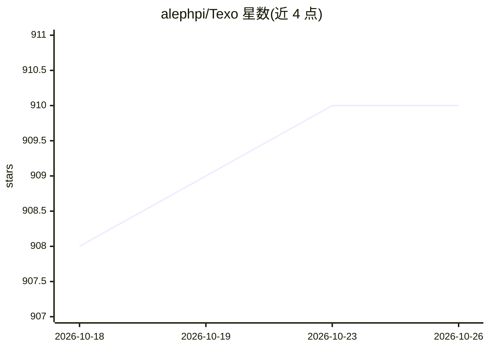

# alephpi/Texo

⭐ 910 · Python · AGPL-3.0 · 推送 2026-09-18 · [GitHub](https://github.com/alephpi/Texo) · [官网](https://texocr.netlify.app/) · 个人维护 · 中文 README

**20M 参数的 LaTeX 公式 OCR 模型，可在浏览器运行**

开源 LaTeX 公式识别模型，仅 20M 参数，由 PPFormulaNet-S 蒸馏并在 UniMERNet-1M 上微调，提供 distill 与 transfer 两种版本，含 ONNX 导出版；在 UniMERNet-Test 上报告 BLEU 与编辑距离指标。支持浏览器端推理，提供在线 demo 与技术报告（arXiv/HAL）。训练全流程开源：hydra 管理配置、uv 同步环境、脚本从 Hugging Face 拉取模型与数据集，可在消费级 GPU（最低 16G 显存）上训练，支持 Slurm 集群运行。代码同时作为教程组织，AGPL-3.0 许可，另对特定个人授予限定的 LGPL-2.1 例外。

## 筛选速览

| 维度 | 判定 | 备注 |
|---|---|---|
| AI 角色 | `ai-native` | 本体是模型或模型工具 |
| 许可风险 | `viral` | AGPL-3.0 |
| 部署形态 | `None` |  |
| 模型依赖 | — | README 未给出锁定关系 |
| 硬件要求 | `gpu-24g` | |
| 安装摩擦 | `low` | 无编译、无系统依赖或容器化 |
| 成熟度 | — | 结构信号不足 |

## 能力要点

- 20M 参数，蒸馏自 PPFormulaNet-S 并在 UniMERNet-1M 微调
- 支持浏览器端运行与 ONNX 导出
- 训练全流程开源，最低 16G GPU 显存可训练
- hydra 管理训练配置，支持 Slurm 集群多运行

## 适用场景

- 识别图片中的数学公式并转为 LaTeX
- 在浏览器中本地做公式 OCR 推理
- 复现或改进轻量级公式识别模型的训练

## 场景标签

`OCR` · 领域:感知与多模态

## 证据(README 行号)

> L6:  A minimalist free and open-source SOTA LaTeX OCR model which contains only 20M parameters.
> L26: Texo is a distilled version of PPFormulaNet-S and finetuned on UniMERNet-1M, hence it should preserve the most part

## 星数曲线

2026-10-18 908 → 2026-10-26 910（+2）

---
*卡片 v1 · prompt 1.4 · 生成 2026-10-21 · 置信度 high · 依据 README sha `576ff3a28a8a` · [字段定义](../../DATASET.md)*
