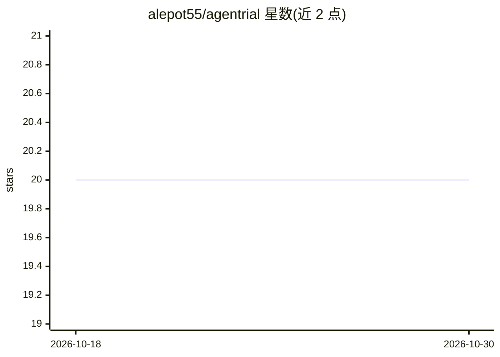

# alepot55/agentrial

⭐ 20 · Python · MIT · 推送 2026-02-06 · [GitHub](https://github.com/alepot55/agentrial) · 个人维护

**AI agent 统计评测框架：多次运行给出置信区间与失败归因**

面向 AI agent 开发者的统计评测框架（自称 'pytest for AI agents'）：将 agent 运行 N 次而非单次，用 Wilson 置信区间、Bootstrap 重采样、Fisher 精确检验等方法输出通过率区间、成本与延迟统计、步骤级失败归因（定位行为分叉的具体步骤）。提供 LangGraph/CrewAI/AutoGen 等 6 种适配器与 OTel 支持，附 CLI、CI/CD 集成（回归时退出码 1 阻断 PR）、本地 FastAPI 仪表盘与 VS Code 扩展。另有 LLM-as-Judge、MCP 配置安全扫描、生产漂移监测等功能。MIT 协议，Python 3.11+，pip 安装。

## 筛选速览

| 维度 | 判定 | 备注 |
|---|---|---|
| AI 角色 | `ai-ecosystem` | LLM/agent 周边工具 |
| 许可风险 | `permissive` | MIT |
| 部署形态 | `library` | 以包/库形式分发 |
| 模型依赖 | — | README 未给出锁定关系 |
| 硬件要求 | — | 无带数字的原话,不猜 |
| 安装摩擦 | `low` | 无编译、无系统依赖或容器化 |
| 成熟度 | — | 结构信号不足 |

## 能力要点

- N 次试运行的 Wilson 置信区间与 Bootstrap 成本/延迟统计
- 步骤级失败归因：Fisher 精确检验定位通过/失败运行的行为分叉步骤
- 6 种框架适配器（LangGraph/CrewAI/AutoGen/Pydantic AI 等）+ OTel 自动捕获
- CI/CD 集成与版本间回归检测（Fisher 精确检验、Mann-Whitney U）

## 适用场景

- 在 CI 中对 agent 做多次运行评测并用退出码阻断回归 PR
- 定位 agent 多步任务中导致失败的具体步骤
- 跨版本对比通过率、成本与延迟的统计显著性差异

## 场景标签

`模型评测` `MLOps` · 领域:评测与运维

## 证据(README 行号)

> L3:  The pytest for AI agents. Run your agent 100 times, get confidence intervals instead of anecdotes.
> L42: **Step-level failure attribution.** When tests fail, agentrial compares trajectories from passing and failing runs.
> L87: |**LangGraph**|`wrap_langgraph_agent`|Callbacks, trajectory, tokens, cost|

## 星数曲线

2026-10-18 20 → 2026-10-30 20（+0）

---
*卡片 v1 · prompt 1.4 · 生成 2026-10-28 · 置信度 high · 依据 README sha `990b43b8ef10` · [字段定义](../../DATASET.md)*
