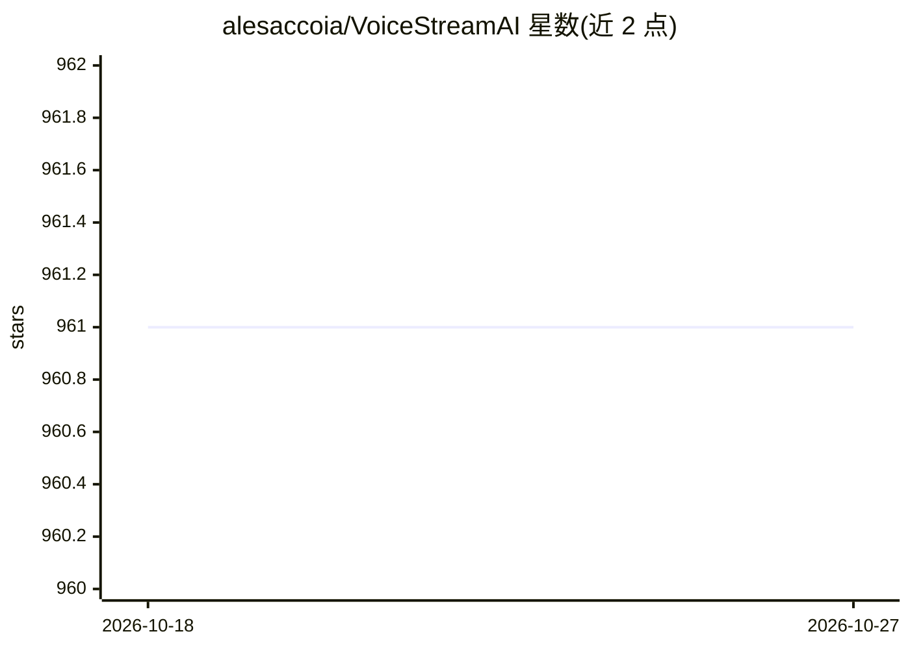

# alesaccoia/VoiceStreamAI

⭐ 961 · Python · MIT · 推送 2026-08-13 · [GitHub](https://github.com/alesaccoia/VoiceStreamAI) · 个人维护

**自托管 Whisper 的近实时流式语音转录服务（Python 服务端 + JS 客户端）**

基于 WebSocket 的近实时音频流转录方案：Python 服务端结合 HuggingFace 语音活动检测（VAD，默认 Silero，可选 pyannote）与 OpenAI Whisper 模型（默认 faster-whisper）进行语音转文字，JavaScript 浏览器客户端负责音频采集与配置。VAD 与 ASR 组件采用工厂/策略模式，可扩展替换；支持多语言转录、SSL 安全连接、按客户端自定义分块策略。提供 Docker 与手动 pip 安装两种部署方式，需 Python 3.8+；GPU（如 Tesla T4）下单段处理约需数秒，小分块存在上下文丢失与准确率波动，当前通过保存音频文件再送模型处理。

## 筛选速览

| 维度 | 判定 | 备注 |
|---|---|---|
| AI 角色 | `ai-native` | 本体是模型或模型工具 |
| 许可风险 | `permissive` | MIT |
| 部署形态 | `self-host` | docker 或自建部署 |
| 模型依赖 | — | README 未给出锁定关系 |
| 硬件要求 | — | 无带数字的原话,不猜 |
| 安装摩擦 | `low` | 无编译、无系统依赖或容器化 |
| 成熟度 | — | 结构信号不足 |

## 能力要点

- WebSocket 近实时音频流转录，默认 faster-whisper，可选 whisper-large-v3
- VAD 组件可切换：Silero（免 token）/pyannote/none
- 工厂与策略模式，VAD/ASR/分块策略均可扩展
- 支持多语言、SSL 安全 WebSocket 与按客户端配置

## 适用场景

- 在自有服务器上搭建近实时语音转文字服务
- 为 Web 应用提供流式音频转录的 WebSocket 后端
- 替换/对比不同 VAD 与 ASR 模型做语音识别实验

## 场景标签

`语音识别` · 领域:感知与多模态

## 证据(README 行号)

> L5: VoiceStreamAI is a Python 3 -based server and JavaScript client solution that
> L7: system employs Huggingface's Voice Activity Detection (VAD) and OpenAI's Whisper
> L148:  Utilizes Faster Whisper or

## 星数曲线

2026-10-18 961 → 2026-10-27 961（+0）

---
*卡片 v1 · prompt 1.4 · 生成 2026-10-21 · 置信度 mid · 依据 README sha `23780777034b` · [字段定义](../../DATASET.md)*
