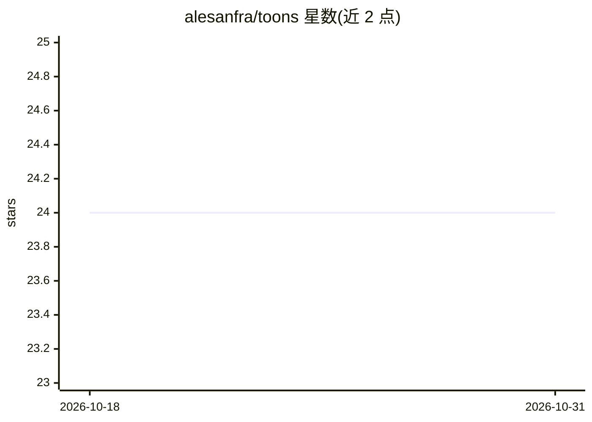

# alesanfra/toons

⭐ 24 · Rust · Apache-2.0 · 推送 2026-09-29 · [GitHub](https://github.com/alesanfra/toons) · 个人维护

**Python 的 TOON 格式解析/序列化库，面向 LLM 上下文省 token**

以 Rust 实现、经 PyO3 绑定提供 Python 接口的 TOON（Token Oriented Object Notation）解析与序列化库，API 形状与标准库 json 模块一致。TOON 是一种面向大语言模型上下文的省 token 序列化格式，README 给出比 JSON 少 30-60% token 的示例（按 Anthropic Claude tokenizer 计量）。实现 TOON 规范 v4.1，每次构建用官方一致性 fixtures 验证；v4.0 起移除 key folding/路径展开选项。pip 安装，随 wheel 附带类型存根；部分平台不再提供二进制 wheel，需 Rust 编译器从源码安装。

## 筛选速览

| 维度 | 判定 | 备注 |
|---|---|---|
| AI 角色 | `ai-ecosystem` | LLM/agent 周边工具 |
| 许可风险 | `permissive` | Apache-2.0 |
| 部署形态 | `library` | 以包/库形式分发 |
| 模型依赖 | — | README 未给出锁定关系 |
| 硬件要求 | — | 无带数字的原话,不猜 |
| 安装摩擦 | `low` | 无编译、无系统依赖或容器化 |
| 成熟度 | — | 结构信号不足 |

## 能力要点

- Rust 实现的 TOON v4.1 解析/序列化，API 镜像 json 模块
- README 示例称比等价 JSON 少 30-60% token（以 Anthropic tokenizer 计量）
- 每版发布对照官方 conformance fixtures 验证
- wheel 附带类型存根，运行时可读 __toon_spec__

## 适用场景

- 把结构化数据写进 LLM prompt 时减少 token 消耗
- 在 Python 中以熟悉的 json 式 API 读写 TOON 格式
- 处理带注释、嵌套字段组、keyed tabular 形式的 TOON v4 数据

## 场景标签

 · 领域:LLM 基础设施/数据序列化

## 证据(README 行号)

> L12: TOONS is a Rust implementation with a Python interface that mirrors the `json`
> L13: module, for the TOON format: a token-efficient serialization format designed

## 星数曲线

2026-10-18 24 → 2026-10-31 24（+0）

---
*卡片 v1 · prompt 1.4 · 生成 2026-10-27 · 置信度 high · 依据 README sha `38595288a725` · [字段定义](../../DATASET.md)*
