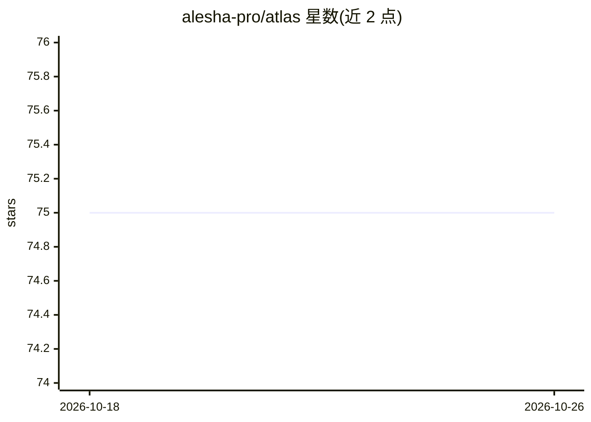

# alesha-pro/atlas

⭐ 75 · TypeScript · MIT · 推送 2026-09-02 · [GitHub](https://github.com/alesha-pro/atlas) · [官网](https://atlas.alesha.pro) · 个人维护

**逐张量解剖 LLM 检查点的交互式可视化画布**

面向需要审视大模型权重的开发者与研究者的可视化工具：读取 safetensors 分片目录，对每个权重张量实测 INT8/INT4/FP8 量化的 SQNR 误差、直方图、SVD 谱与离群通道，将全部张量铺在可平移缩放的单一画布上。内置 Qwen3.8-27B 与 GLM-5.3-Flash NVFP4 两份解剖数据，支持运行 bf16 检查点采集真实激活与注意力（living model 区），并提供脚本让用户扫描自有 checkpoint 接入。前端为静态站点，零运行时依赖。

## 筛选速览

| 维度 | 判定 | 备注 |
|---|---|---|
| AI 角色 | `ai-ecosystem` | LLM/agent 周边工具 |
| 许可风险 | `permissive` | MIT |
| 部署形态 | `library` | 以包/库形式分发 |
| 模型依赖 | — | README 未给出锁定关系 |
| 硬件要求 | — | 无带数字的原话,不猜 |
| 安装摩擦 | `medium` | 含编译或系统依赖之一 |
| 成熟度 | — | 结构信号不足 |

## 能力要点

- 每个张量的 INT8 per-channel / INT4 group-128 / FP8 e4m3 实测 SQNR
- 1199 个张量单画布呈现：列=层，行=角色，可平移缩放
- living model 区以 hooks 运行 bf16 检查点采集真实激活、注意力与逐层 INT4 脆弱性（KL 散度）
- 扫描脚本 116 秒（单 GPU，27B 模型），支持接入自有 checkpoint

## 适用场景

- 判断模型中哪些部分可无损压缩、量化哪些张量会受损
- 审查 MoE 模型的专家路由、REAP 分数与剪枝候选
- 查看逐层激活、注意力熵与线性注意力记忆的实测数据

## 场景标签

`模型量化` · 领域:训练与推理

## 证据(README 行号)

> L3:  An interactive canvas for taking a model apart, tensor by tensor.
> L33: Nothing here is a heuristic or a rule of thumb. Each weight tensor was actually
> L42: The scan is a single script over the shards, 116 seconds on one GPU for a 27B

## 星数曲线

2026-10-18 75 → 2026-10-26 75（+0）

---
*卡片 v1 · prompt 1.4 · 生成 2026-10-24 · 置信度 mid · 依据 README sha `0ea2dd02ff07` · [字段定义](../../DATASET.md)*
