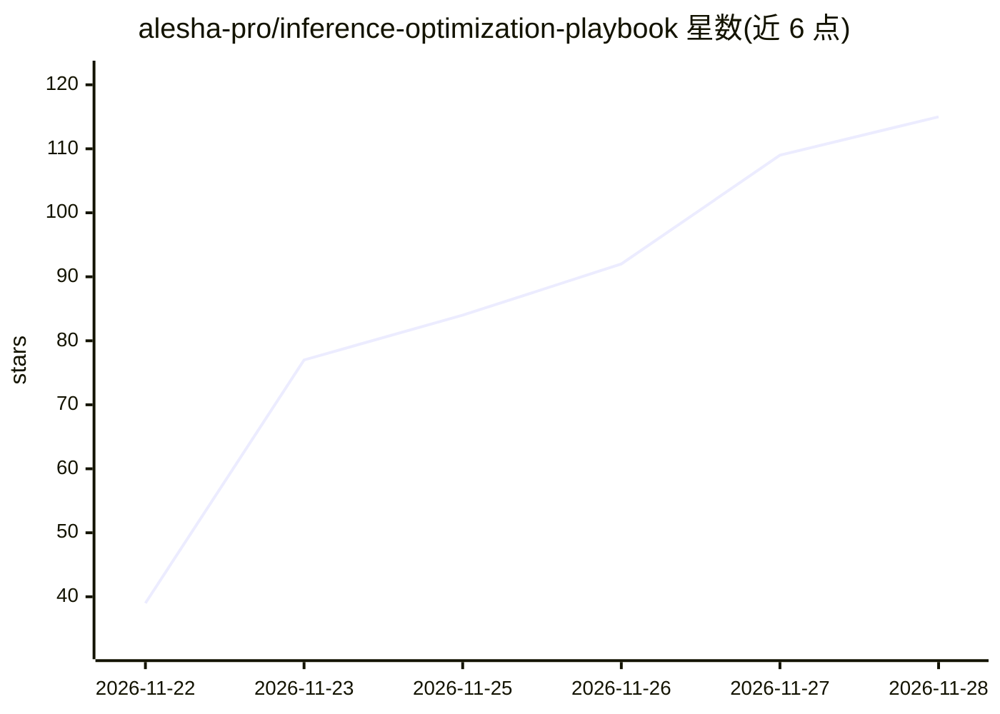

# alesha-pro/inference-optimization-playbook

⭐ 115 · Python · MIT · 推送 2026-11-26 · [GitHub](https://github.com/alesha-pro/inference-optimization-playbook) · 个人维护

**消费级 GPU 上 MoE 大模型推理调优的实测假设手册，供人与编码 Agent 使用**

作者在 1-4 张 RTX 3090 上对 7 个 MoE 模型案例积累的调优笔记，汇总为 138 条已测试假设的台账，每条含结论、测量数据与测试条件，包括失败结果（如 drafter 微调无收益、O_DIRECT 低于缓冲读）。仓库同时是一个 skill 目录（SKILL.md + 2 个标准库 Python 脚本），Agent 通过填写 situation card 生成标签并用 grep 过滤台账。测量多为单活跃请求，仿真/计算/外部数据等以标签区分。

## 筛选速览

| 维度 | 判定 | 备注 |
|---|---|---|
| AI 角色 | `ai-knowledge` | 知识聚合/清单类 |
| 许可风险 | `permissive` | MIT |
| 部署形态 | `None` |  |
| 模型依赖 | local-ok | 支持本地模型 |
| 硬件要求 | — | 无带数字的原话,不猜 |
| 安装摩擦 | `medium` | 含编译或系统依赖之一 |
| 成熟度 | — | 结构信号不足 |

## 能力要点

- 138 条测试假设的台账，含结论、数值与测试条件，含失败案例
- 按机制组织的 15 章 playbook，按工况/症状入口查找
- 仓库即 skill 目录，Agent 生成标签行后 grep 过滤台账
- 附 route_sim.py 等标准库脚本做路由与缓存行为估算

## 适用场景

- 查询我的硬件/模型组合下某优化思路是否已被验证过
- 让编码 Agent 依据台账为本地推理排障并规划实验
- 在新 MoE 模型上按 checklist 从零启动并复测机制

## 场景标签

`教程课程` · 领域:学习与行业

## 证据(README 行号)

> L3: My field notebook for tuning LLM inference on consumer GPUs. The ledger covers 138 tested hypotheses across 7 model 
> L54: The repo root is a skill directory: `SKILL.md`, plain markdown and 2 standard-library Python scripts.

## 星数曲线

2026-11-22 39 → 2026-11-28 115（+76）

---
*卡片 v1 · prompt 1.4 · 生成 2026-11-28 · 置信度 high · 依据 README sha `348f006c7483` · [字段定义](../../DATASET.md)*
