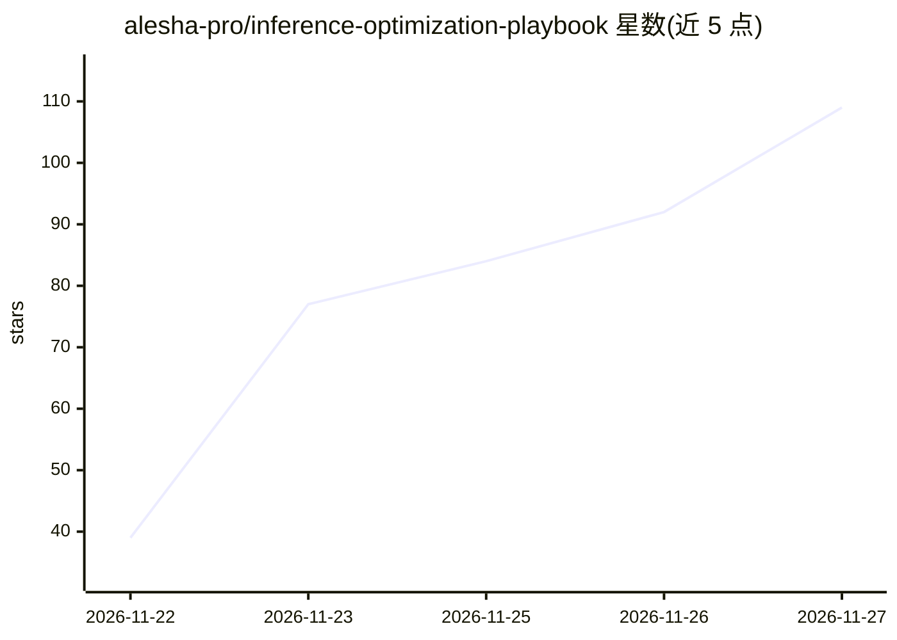

# alesha-pro/inference-optimization-playbook

⭐ 109 · Python · MIT · 推送 2026-11-26 · [GitHub](https://github.com/alesha-pro/inference-optimization-playbook) · 个人维护

**消费级 GPU 上运行大型 MoE LLM 的调优经验手册**

收录 115 个经过实测的推理加速假设（含 97 条结论），每条记录结果、数据、原因与测试条件，内容来自在 4x RTX 3090 加 RAM 专家卸载配置上运行多款 MoE 模型。手册按机制组织为 16 章，通过情况卡与标签系统帮助读者按自身条件定位适用结论；仓库根目录同时是符合 SKILL.md 规范的技能目录，可直接交给编码 agent 使用。作者声明数据来自单一平台，不提供基准测试工具。

## 筛选速览

| 维度 | 判定 | 备注 |
|---|---|---|
| AI 角色 | `ai-knowledge` | 知识聚合/清单类 |
| 许可风险 | `permissive` | MIT |
| 部署形态 | `None` |  |
| 模型依赖 | local-ok | 支持本地模型 |
| 硬件要求 | — | 无带数字的原话,不猜 |
| 安装摩擦 | `medium` | 含编译或系统依赖之一 |
| 成熟度 | — | 结构信号不足 |

## 能力要点

- 115 个实测假设，每条含 worked/failed/conditional 判定与数字
- 情况卡+标签系统按条件筛选适用结论
- 仓库根目录即 SKILL.md 技能目录，可被编码 agent 直接读取
- 16 章各附迁移到其他模型的检查清单

## 适用场景

- 调优本地 LLM 推理前先查相同条件下是否已试过
- 让编码 agent 按手册规划 MoE 模型在受限硬件上的部署
- 判断投机解码、专家卸载等方案在自己硬件上是否值得尝试

## 场景标签

`教程课程` · 领域:学习与行业

## 证据(README 行号)

> L3: A map of 115 tested ideas for making huge LLMs fast on consumer GPUs. Each one has a verdict (worked, failed, or wor
> L37: - **Coding agents** that do the tuning for them. The repo root is a ready skill.
> L56: playbook/    16 chapters by mechanism

## 星数曲线

2026-11-22 39 → 2026-11-27 109（+70）

---
*卡片 v1 · prompt 1.4 · 生成 2026-11-22 · 置信度 high · 依据 README sha `80e0d1a5936e` · [字段定义](../../DATASET.md)*
