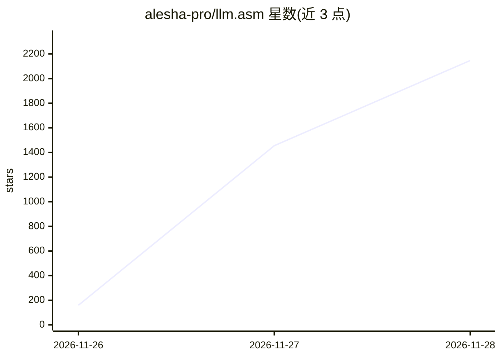

# alesha-pro/llm.asm

⭐ 2,147 · Assembly · MIT · 推送 2026-11-27 · [GitHub](https://github.com/alesha-pro/llm.asm) · 个人维护

**纯 x86-64 汇编实现的 Qwen3 推理、裸机 OS 与 Mini-GPT 训练器**

三个用 100% NASM 汇编编写的完整 LLM 项目：14.7 KB 的 Qwen3-0.6B 推理程序（内置 BPE 分词器、AVX2+FMA GEMM、多轮 KV-cache 聊天 REPL）、24 KB 可裸机启动直接运行 Qwen3 的 OS（Multiboot→Long Mode→SMP→VGA 聊天界面）、32 KB 从零实现的 Mini-GPT 训练器（AdamW、解析反向传播、实时 Braille TUI）。零 C/libc/运行时依赖，git clone 后 make 构建。需支持 AVX2+FMA+F16C 的 x86-64 CPU 与 Linux；附性能与数值一致性验证数据。

## 筛选速览

| 维度 | 判定 | 备注 |
|---|---|---|
| AI 角色 | `ai-native` | 本体是模型或模型工具 |
| 许可风险 | `permissive` | MIT |
| 部署形态 | `None` |  |
| 模型依赖 | — | README 未给出锁定关系 |
| 硬件要求 | `cpu-ok` | |
| 安装摩擦 | `low` | 无编译、无系统依赖或容器化 |
| 成熟度 | — | 结构信号不足 |

## 能力要点

- 14 KB 单二进制运行 Qwen3-0.6B，含内置 BPE 分词器与多轮聊天
- 24 KB 可裸机启动的 OS，无需 Linux/Windows 直接运行模型聊天
- 32 KB 从零 GPT 训练器，带实时 80x24 Braille TUI 与 AdamW 优化器
- 与 PyTorch FP32 参考做数值一致性验证

## 适用场景

- 在无 libc、零依赖环境下运行本地 LLM 推理
- 学习 transformer 推理内核在汇编层的实现方式
- 在裸机或虚拟机上直接启动一个可对话的 LLM 系统
- 从零训练小型 GPT 并实时观察训练过程

## 场景标签

`推理引擎` `模型训练` · 领域:训练与推理

## 证据(README 行号)

> L3: **Three complete LLM projects written in 100% pure x86-64 NASM assembly.**
> L12: |**01-qwen3-inference/**|`build/asm-llm`|**14,712 B** *(14,008 B `FAST_Q8=0`)*|**0**|Pure x86-64 NASM static Linux 
> L117: - **CPU:** x86-64 with **AVX2 + FMA + F16C** (Intel Haswell / AMD Excavator or newer).

## 星数曲线

2026-11-26 159 → 2026-11-28 2,147（+1,988）

---
*卡片 v1 · prompt 1.4 · 生成 2026-11-28 · 置信度 high · 依据 README sha `061ad85d93a4` · [字段定义](../../DATASET.md)*
