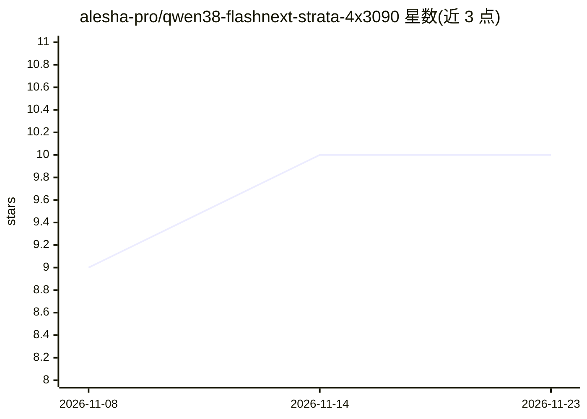

# alesha-pro/qwen38-flashnext-strata-4x3090

⭐ 10 · Python · NOASSERTION · 推送 2026-11-05 · [GitHub](https://github.com/alesha-pro/qwen38-flashnext-strata-4x3090) · 个人维护

**在双 RTX 3090 上运行 Qwen3.8-Flash-Next 的完整复现配方**

记录在 2x RTX 3090（48 GB VRAM）上以 262K 上下文运行 Qwen3.8-Flash-Next GGUF 量化模型的技术配方：Strata 0.2.10 引擎将常用专家留在 GPU、其余在 CPU 计算，配合 DFlash2 投机解码 drafter 与 unsloth UD-IQ4_XS 量化，代码解码约 150 tok/s。仓库提供带 SHA256 校验的固定版本、服务器配置、关键启动参数、原始基准数据、拒绝向量及跨重启会话补丁，不含权重本身。

## 筛选速览

| 维度 | 判定 | 备注 |
|---|---|---|
| AI 角色 | `ai-knowledge` | 知识聚合/清单类 |
| 许可风险 | `none` | NOASSERTION |
| 部署形态 | `None` |  |
| 模型依赖 | — | README 未给出锁定关系 |
| 硬件要求 | — | 无带数字的原话,不猜 |
| 安装摩擦 | `medium` | 含编译或系统依赖之一 |
| 成熟度 | — | 结构信号不足 |

## 能力要点

- 专家缓存分层：GPU 放常用专家、CPU 计算其余，模型超出 48 GB VRAM 仍可运行
- DFlash2 投机解码 drafter 与 MTP 对比的基准数据
- mix-r1 拒绝向量及 AdvBench/JailbreakBench/Harmless 测评结果
- 跨重启会话补丁（PR #2590 移植到 0.2.10）与完整 bench 原始数据

## 适用场景

- 在 2 张 24 GB 消费级 GPU 上本地部署 262K 上下文大模型
- 按配方复现基准测试结果并查看原始 trace
- 为本地推理服务配置投机解码与拒绝向量

## 场景标签

`模型量化` `推理引擎` · 领域:训练与推理

## 证据(README 行号)

> L18: This repo is the full recipe: pinned versions with checksums, the exact server config, every flag that mattered, th
> L14: The model does not fit in 48 GB of VRAM. The weights are 65 GB plus a 29 GB n-gram table, and Strata keeps the most
> L75: |Engine|Strata 0.2.10 (Control and engine 0.1.56)|`Niko1221/Strata` release v0.2.10, `linux-x86_64-cuda-cuda13`|

## 星数曲线

2026-11-08 9 → 2026-11-23 10（+1）

---
*卡片 v1 · prompt 1.4 · 生成 2026-11-20 · 置信度 high · 依据 README sha `419450c65f9e` · [字段定义](../../DATASET.md)*
