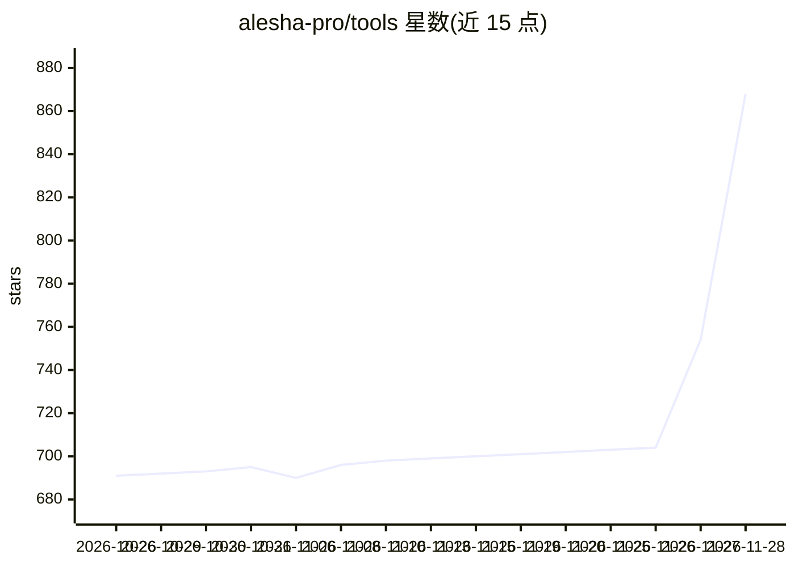

# alesha-pro/tools

⭐ 868 · HTML · MIT · 推送 2026-11-26 · [GitHub](https://github.com/alesha-pro/tools) · 个人维护

**个人本地推理工作台的 ComfyUI 工作流与基准配置集合**

作者在 4x RTX 3090 本地推理主机上构建的工具集合，按独立小节组织：MiniMax H3 带同步音频的视频生成工作流、Qwen 图像生成与透明 PNG 工作流、Colab 上运行 GLM 大模型并暴露 OpenAI/Anthropic 端点的配置、以及两个 Canvas 2D 动画 agent skills。每个小节自带安装器与文档，基准数据来自实机运行记录。

## 筛选速览

| 维度 | 判定 | 备注 |
|---|---|---|
| AI 角色 | `ai-native` | 本体是模型或模型工具 |
| 许可风险 | `permissive` | MIT |
| 部署形态 | `None` |  |
| 模型依赖 | — | README 未给出锁定关系 |
| 硬件要求 | `gpu-24g` | |
| 安装摩擦 | `low` | 无编译、无系统依赖或容器化 |
| 成熟度 | — | 结构信号不足 |

## 能力要点

- 13 个 ComfyUI 视频工作流，含多 GPU 版（四卡 3.12x 加速）与单 24GB 卡版本
- RTX 3090 单卡图像生成工作流，提供低显存 GGUF 指南与 SHA-256 模型校验
- Colab 配置暴露本地 OpenAI 与 Anthropic 兼容端点，附吞吐数据
- 两个独立 agent skills：手绘动画与产品短片生成

## 适用场景

- 在自己的多卡工作站上批量生成带音频的视频
- 单张 24GB 显卡上运行图像生成与编辑工作流
- 在租用 GPU 环境上搭建大模型本地 API 端点
- 查找可复用的 Canvas 动画 agent skill

## 场景标签

`图像生成` `视频生成` · 领域:内容生成

## 证据(README 行号)

> L22: Thirteen ComfyUI workflows in two sets. One set runs on any single 24 GB card. The
> L35: Image generation, editing and transparent PNGs on **one GPU**. The baseline is
> L61: 1,000 CU on Ultra). Exposes local OpenAI (`/v1`), Anthropic (`/v1/messages`),

## 星数曲线

2026-10-26 691 → 2026-11-28 868（+177）

---
*卡片 v1 · prompt 1.4 · 生成 2026-11-27 · 置信度 high · 依据 README sha `c076dc0d98dd` · [字段定义](../../DATASET.md)*
