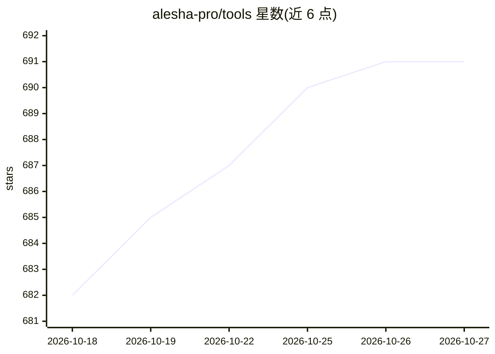

# alesha-pro/tools

⭐ 691 · HTML · MIT · 推送 2026-09-28 · [GitHub](https://github.com/alesha-pro/tools) · 个人维护

**本地 4x RTX 3090 推理机上的 ComfyUI 工作流与工具集合**

个人维护的多模块仓库，围绕自建 4x RTX 3090（96 GB 显存）本地推理设备产出工具：MiniMax H3 音视频生成的 13 个 ComfyUI 工作流（单卡 24GB 与四卡两组，四卡加速 3.12x）；Qwen-Image-2.1 图像生成/编辑的 5 个原生工作流与低显存 GGUF 指南；两个独立 agent 技能（手绘 Canvas 动画、motion-reel 产品影片）。各模块自带独立安装器与文档，附实测基准数据，MIT 许可。

## 筛选速览

| 维度 | 判定 | 备注 |
|---|---|---|
| AI 角色 | `ai-ecosystem` | LLM/agent 周边工具 |
| 许可风险 | `permissive` | MIT |
| 部署形态 | `None` |  |
| 模型依赖 | — | README 未给出锁定关系 |
| 硬件要求 | — | 无带数字的原话,不猜 |
| 安装摩擦 | `low` | 无编译、无系统依赖或容器化 |
| 成熟度 | — | 结构信号不足 |

## 能力要点

- 13 个 MiniMax H3 ComfyUI 工作流，含多 GPU 并行（四卡 3.12x 加速）
- Qwen-Image-2.1 单卡工作流，含 INT8 权重、SHA-256 校验与低显存 GGUF 指南
- 两个不依赖视频生成模型的 agent 技能（Canvas 2D 动画/产品影片）
- 4x RTX 3090 实测基准与原始日志

## 适用场景

- 在单张 24GB 显存显卡上本地跑 MiniMax H3 或 Qwen-Image 视频/图像生成
- 多 GPU 机器上缩短视频采样时间
- 给 agent 添加手绘动画或产品影片制作技能

## 场景标签

`图像生成` `视频生成` · 领域:内容生成

## 证据(README 行号)

> L22: Thirteen ComfyUI workflows in two sets. One set runs on any single 24 GB card. The
> L38: Five native ComfyUI workflows, an isolated installer, SHA-256 model verification,
> L93: I post the benchmarks behind all of this. Local inference on 4x RTX 3090,

## 星数曲线

2026-10-18 682 → 2026-10-27 691（+9）

---
*卡片 v1 · prompt 1.4 · 生成 2026-10-21 · 置信度 high · 依据 README sha `51e1ca4808b7` · [字段定义](../../DATASET.md)*
