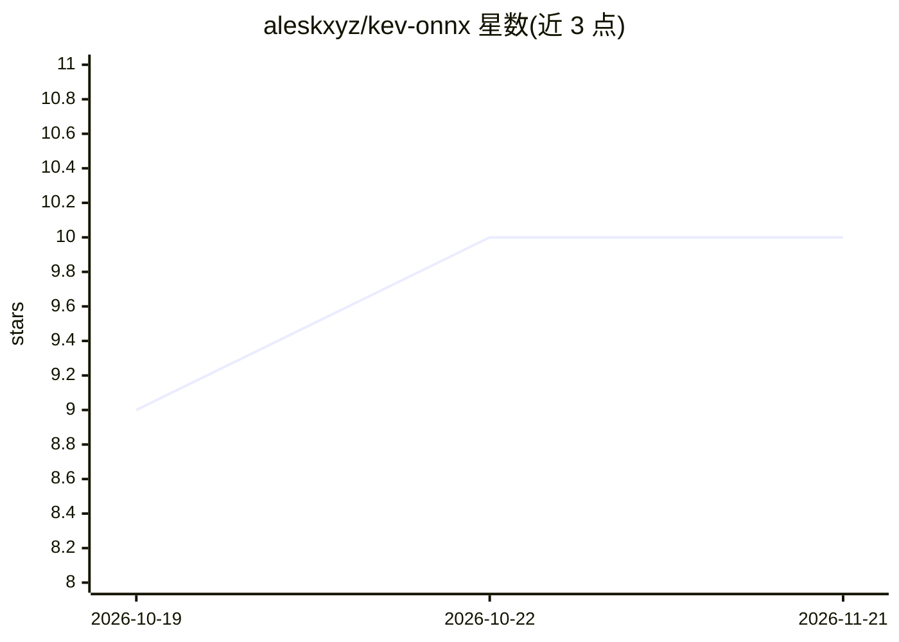

# aleskxyz/kev-onnx

⭐ 10 · Python · Apache-2.0 · 推送 2026-09-27 · [GitHub](https://github.com/aleskxyz/kev-onnx) · 个人维护

**自托管 KEV 决策模型 ONNX 推理 API 服务器（CPU 即可）**

将 KEV 决策模型封装为 TypeSafe 兼容的 /v1/systemone API：请求提交一段 state 与若干带类型的问题（choice/noul/score），单次前向传播返回每个候选答案的校准概率，无需解析生成文本。默认从 Hugging Face 拉取 onnx-community/kev-4b-ONNX 量化模型，经 onnxruntime 以 CPUExecutionProvider 运行，仅需约 4 核与 4 GB 内存。仓库只含服务代码，不打包模型权重；首次启动需联网下载模型。并发请求在固定线程池上排队，扩展靠多副本加负载均衡。

## 筛选速览

| 维度 | 判定 | 备注 |
|---|---|---|
| AI 角色 | `ai-ecosystem` | LLM/agent 周边工具 |
| 许可风险 | `permissive` | Apache-2.0 |
| 部署形态 | `self-host` | docker 或自建部署 |
| 模型依赖 | — | README 未给出锁定关系 |
| 硬件要求 | `cpu-ok` | |
| 安装摩擦 | `low` | 无编译、无系统依赖或容器化 |
| 成熟度 | — | 结构信号不足 |

## 能力要点

- 与 TypeSafe 托管 API 同构的 /v1/systemone 线协议，客户端无需改动
- 三种问题类型：choice 多选一、noul 校准是/否、score 有序评分分布
- 量化 ONNX 经 onnxruntime 纯 CPU 推理，单容器部署（GHCR 镜像，amd64/arm64）
- 环境变量配置模型仓库、文件名、线程数与 token 上限

## 适用场景

- 不想依赖 GPU 也要在本地或内网运行 KEV 决策模型 API
- 把已有对接 TypeSafe 托管 API 的客户端迁移到自托管服务器
- 对工单/文档等上下文批量产出分类概率或评分分布
- 在低配机器上以 q4 量化模型获得约 1-1.6 秒的单请求延迟

## 场景标签

`推理引擎` · 领域:训练与推理

## 证据(README 行号)

> L5: Self-hosted, TypeSafe-compatible API server for **KEV**, a *decision model*: instead of generating
> L13: - **CPU-only, no GPU needed.** Runs a quantized ONNX build of KEV via `onnxruntime`.
> L53: Every request is a `POST` to `/v1/systemone` with a `state` and one or more named `questions`.

## 星数曲线

2026-10-19 9 → 2026-11-21 10（+1）

---
*卡片 v1 · prompt 1.4 · 生成 2026-11-20 · 置信度 high · 依据 README sha `8ba10e1a359a` · [字段定义](../../DATASET.md)*
