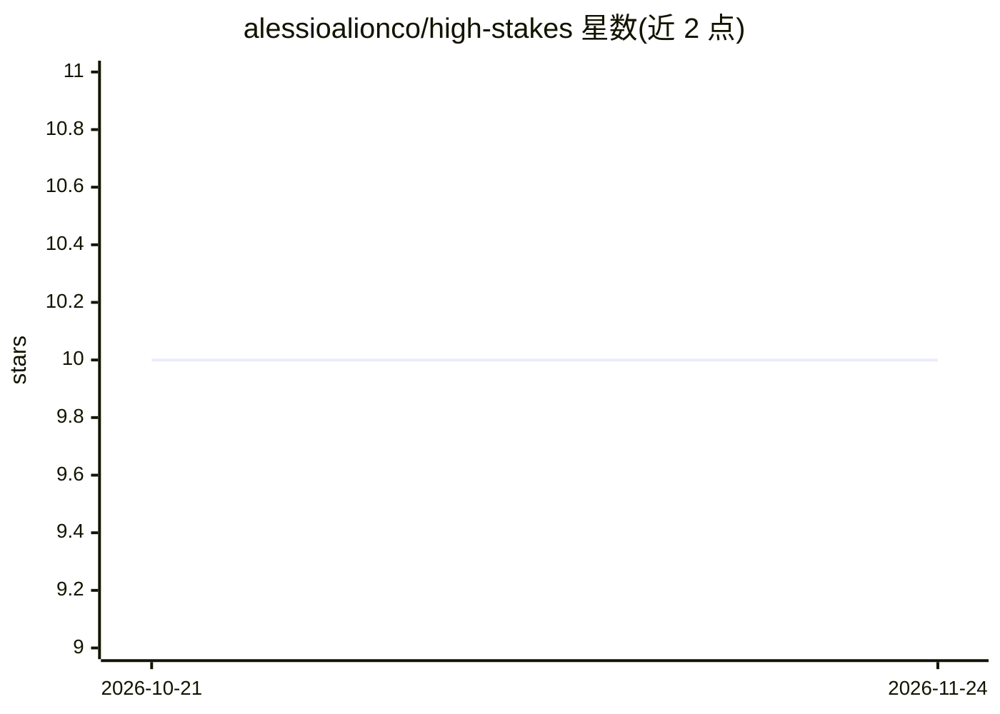

# alessioalionco/high-stakes

⭐ 10 · Python · Apache-2.0 · 推送 2026-08-10 · [GitHub](https://github.com/alessioalionco/high-stakes) · 个人维护

**为重大决策组建多模型对抗式 AI 专家委员会的工具**

面向不可撤销的重要决策，引擎按问题类型（专家/对抗/受众代理）自动组建虚拟委员会，每个席位代表一种决策失效视角，并刻意分配到不同的模型家族。运行前生成带信任分级的证据包，强制每位顾问给出可证伪的结论而非评论，事后由独立模型逐条反驳共识，并用代码逐字核验档案中所有引语（qverify），防止模型改写被当作真实引用。输出结构化档案：收敛点、分歧、独特观点与主席综合。含成本预估关卡与跨进程的支出上限。

## 筛选速览

| 维度 | 判定 | 备注 |
|---|---|---|
| AI 角色 | `ai-native` | 本体是模型或模型工具 |
| 许可风险 | `permissive` | Apache-2.0 |
| 部署形态 | `library` | 以包/库形式分发 |
| 模型依赖 | locked-api |  |
| 硬件要求 | — | 无带数字的原话,不猜 |
| 安装摩擦 | `low` | 无编译、无系统依赖或容器化 |
| 成熟度 | — | 结构信号不足 |

## 能力要点

- 按问题分类自动组建委员会，每席位运行不同模型家族
- 各顾问×模型为独立 API 调用，代码级保证无上下文泄漏
- qverify 对档案中每条引语做逐字匹配校验
- 首次付费调用前的成本预估关卡与磁盘记账的支出上限

## 适用场景

- 董事会材料提交前压力测试论点
- 团队项目立项前做多视角审查
- 融资叙事在会见投资人前找出薄弱环节

## 场景标签

`多智能体` `AI 助手` · 领域:Agent 开发

## 证据(README 行号)

> L24: high-stakes applies it to decisions.
> L30: is a lens on one way the decision can fail, and each lens runs on a different model family.
> L102: **3. Isolation you can verify.** Each advisor × model pair is one API call with a clean

## 星数曲线

2026-10-21 10 → 2026-11-24 10（+0）

---
*卡片 v1 · prompt 1.4 · 生成 2026-11-20 · 置信度 high · 依据 README sha `1dcf51663c77` · [字段定义](../../DATASET.md)*
