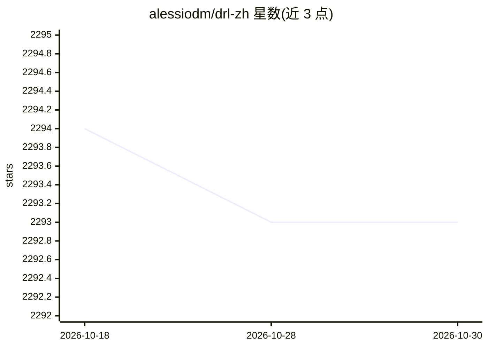

# alessiodm/drl-zh

⭐ 2,293 · Jupyter Notebook · MIT · 推送 2026-05-26 · [GitHub](https://github.com/alessiodm/drl-zh) · 个人维护

**动手实现深度强化学习算法的课程（含 AI 答疑助手）**

从 MDP 与表格 RL 开始，直至 AlphaZero 式规划、RLHF/DPO/GRPO、Decision Transformers、世界模型 Dreamer 与元学习的深度强化学习实践课程。根目录 notebook 为带引导 TODO 的练习版，solution/ 提供完整可运行版本；Docker 工作区内置 VS Code 扩展形式的 AI Companion，按当前 TODO 提供苏格拉底式提示（自带 LLM key，默认 Gemini，支持 OpenAI/Anthropic/Groq）。要求 Python 3.13.x、PyTorch 基础与相关数学背景。

## 筛选速览

| 维度 | 判定 | 备注 |
|---|---|---|
| AI 角色 | `ai-knowledge` | 知识聚合/清单类 |
| 许可风险 | `permissive` | MIT |
| 部署形态 | `self-host` | docker 或自建部署 |
| 模型依赖 | — | README 未给出锁定关系 |
| 硬件要求 | `cpu-ok` | |
| 安装摩擦 | `low` | 无编译、无系统依赖或容器化 |
| 成熟度 | — | 结构信号不足 |

## 能力要点

- 19 组 notebook 覆盖 DQN/PPO/SAC 到 RLHF、Dreamer、MAML
- 练习 notebook 为 TODO 填空式，solution/ 提供完整可运行版本
- Docker 工作区内置 AI Companion（文本/语音、多 LLM 提供方）
- 提供 GPU、CPU-only 与原生（Poetry）三种安装方式

## 适用场景

- 系统学习并亲手实现深度强化学习算法
- 在带 AI 提示的 Docker 工作区中做 RL 练习
- 进阶学习 RLHF、世界模型与元学习并完成课程 capstone

## 场景标签

`教程课程` · 领域:学习与行业

## 证据(README 行号)

> L7: Welcome to drlzh.ai: a hands-on deep reinforcement learning course where you
> L14: The root notebooks are the exercise track: code is intentionally replaced with guided `TODO`

## 星数曲线

2026-10-18 2,294 → 2026-10-30 2,293（-1）

---
*卡片 v1 · prompt 1.4 · 生成 2026-10-21 · 置信度 high · 依据 README sha `869684746de7` · [字段定义](../../DATASET.md)*
