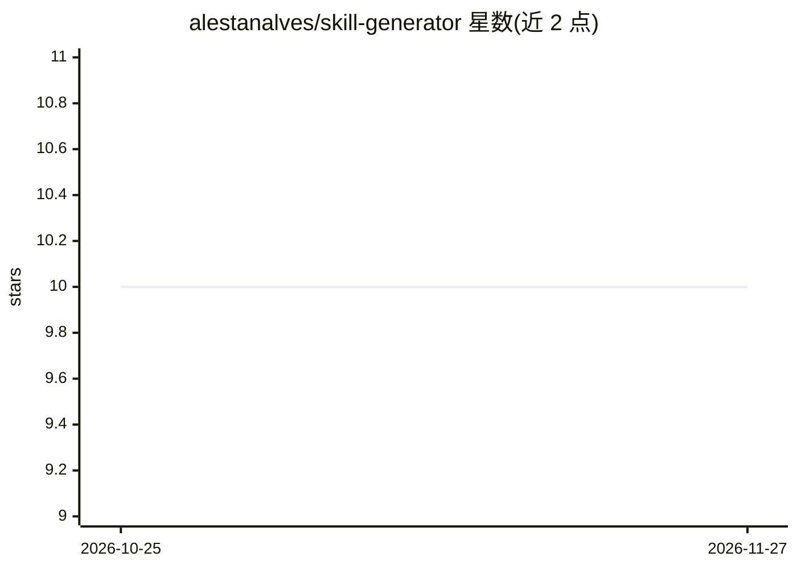

# alestanalves/skill-generator

⭐ 10 · Python · MIT · 推送 2026-04-21 · [GitHub](https://github.com/alestanalves/skill-generator) · 个人维护

**为 Codex 和 Claude Code 生成 SKILL.md 技能的 CLI 工具**

基于 OpenAI Agents SDK 的开源 CLI，以多智能体流水线（规划、撰写、审校、自动修复）生成开放格式 SKILL.md 技能文件，目标平台为 Codex 与 Claude Code（含通用目标）。生成后进行名称、frontmatter、结构与引用的本地校验，并支持以复制或 symlink 方式安装技能。依赖 Python 3.11+，需配置 OPENAI_API_KEY，亦支持通过 OpenAI 兼容端点接入 Ollama 本地模型。默认模型为 gpt-5.3-codex，README 说明最终质量仍取决于用户提供的 briefing 与上下文。

## 筛选速览

| 维度 | 判定 | 备注 |
|---|---|---|
| AI 角色 | `ai-ecosystem` | LLM/agent 周边工具 |
| 许可风险 | `permissive` | MIT |
| 部署形态 | `library` | 以包/库形式分发 |
| 模型依赖 | local-ok | 支持本地模型 |
| 硬件要求 | — | 无带数字的原话,不猜 |
| 安装摩擦 | `low` | 无编译、无系统依赖或容器化 |
| 成熟度 | — | 结构信号不足 |

## 能力要点

- 多智能体流水线：planner/author/review/repair 四阶段生成
- 生成 SKILL.md 开放格式，输出适配 Codex 与 Claude Code 目录结构
- 支持 Ollama 本地模型（OpenAI 兼容端点）
- 本地校验器检查结构，安装支持复制或 symlink

## 适用场景

- 为 Claude Code 或 Codex 批量生成结构化技能文件
- 团队将规范文档转化为可安装的 agent 技能
- 用本地 Ollama 模型离线生成技能

## 场景标签

`提示工程` · 领域:Agent 开发

## 证据(README 行号)

> L5:  CLI open source para gerar skills de alta qualidade para Codex e Claude Code usando o OpenAI Agents SDK.
> L21: - Usa um pipeline multiagente:
> L46: Tambem suporta `Ollama` via endpoint compativel com OpenAI. Nesse caso, configure `SKILL_GENERATOR_PROVIDER=ollama`

## 星数曲线

2026-10-25 10 → 2026-11-27 10（+0）

---
*卡片 v1 · prompt 1.4 · 生成 2026-11-20 · 置信度 high · 依据 README sha `c8be8fd14ba1` · [字段定义](../../DATASET.md)*
